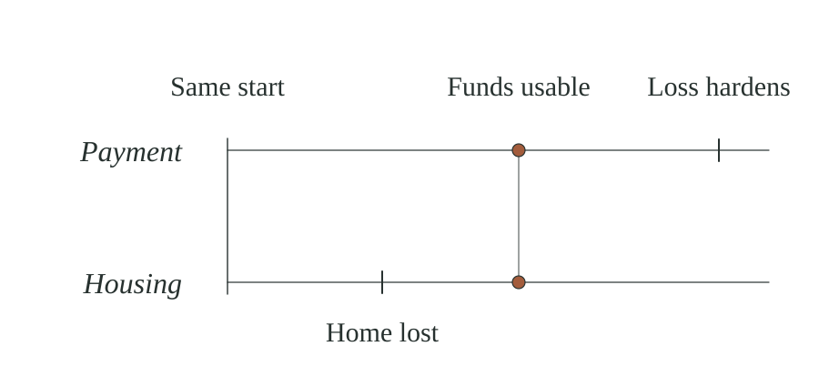
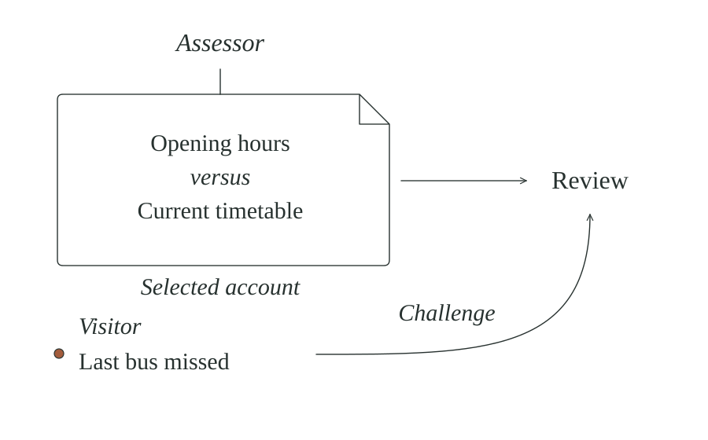
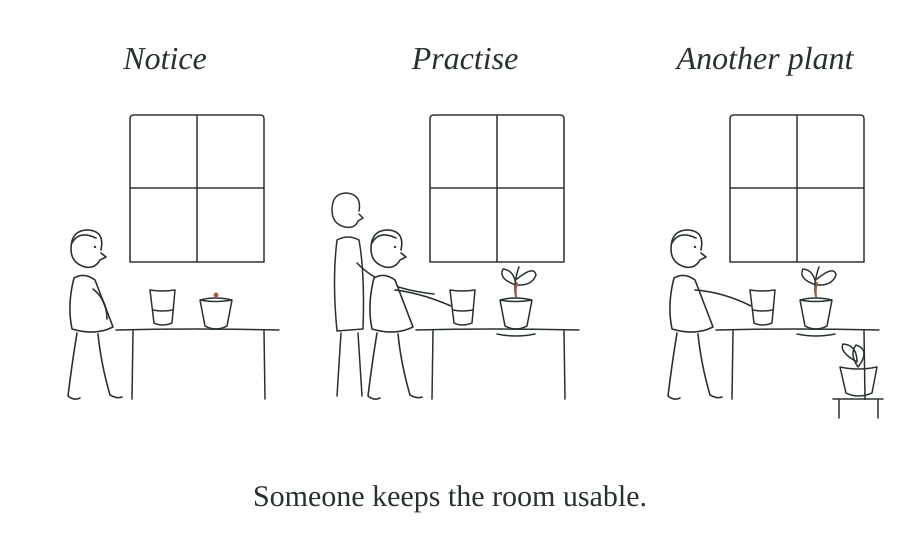

*A complete human-book developmental draft, Mechanical Ethics v1.0 research candidate, 16 October 2026. Edition ME10-DEV4R-CORR2-20261016. NOT RELEASED. DEV4 preserved; missing v0.8 meanings restored in place for human editorial review.*

# A note before we begin

A decision can take minutes or years, and the circumstances it concerns continue to change while the decision is being made. A room grows damp while a repair is discussed; a child learns to make something with the help of an adult; a friendship deepens through ordinary attention. Mechanical Ethics offers a language for following these changes, especially when somebody's ability to respond differs from the speed at which their situation is changing. It is also a way of noticing opportunities that people can create together.

We begin with a glass, a window that limits what can be seen, a seed that may grow and another person whose help changes what is possible. This is what *middle-out* means here: begin with situations a reader can picture, look inward for the conditions that made something happen, and outward towards the people, institutions and systems connected to it. From these small scenes we follow bounded accounts, choices and effects through a shared garden, a library door, a last bus and the different people whose roles must join for a correction to work. Along the way we encounter clocks, hardening harm, uncertainty, power, witnesses, independent challenge and the difference between a reported fix and an actual change. We also ask how care, discovery, relationships, skill and shared effort can open worthwhile futures. By the end, the hope is that a reader can ask more carefully what changed, whose possibilities changed, what remains unknown, who carries the burden, where a challenge can go, what remains unrepaired and which positive possibility might be supported or created. These are questions to take into medicine, law, engineering and public decisions, not answers that replace their specialist methods or legitimate authority. No background in philosophy or mathematics is expected. The occasional symbol is a compact reminder of a relationship explained in the prose.

The same questions can travel from a room to an institution, but their answers do not travel unchanged. One person can move a glass; a public service may depend on a board, staff, contractors, software and the people who use it. We will follow how those contributions meet and where they fail to meet, rather than describe the institution as a single large person. The small situations are therefore foundations for understanding joined systems, not miniature proofs about how every system works.

There is a limit to what this language establishes. It can help trace what was known, what changed, which futures became more or less reachable, and whose capacity to respond differed from their exposure. It cannot assign rights, settle clinical safety, determine legal remedies or derive a moral verdict from a timing diagram. Those require the people concerned, defensible values, specialist evidence and legitimate authority. A boundary drawn for study does not confer moral standing, and describing a power does not give permission to exercise it. The chapters will work within these limits while showing what the descriptions can usefully reveal.

**If you are being harmed now:** do not risk your housing, work, health, family, privacy or personal safety in order to produce evidence for this book. Recording, naming, challenging or publishing what is happening can expose you to retaliation. No one owes this research their testimony. Where appropriate and safe, seek help from emergency services, a medical professional, legal adviser, union, charity or trusted person. You do not have to become an expert in a system that is hurting you before you deserve competent assistance. A record may later support correction, but a witness pack is not rescue and a theory cannot replace protection.

# 1. Before a Choice

A **state** is a description of particular conditions at a moment: the position of a glass, the temperature of its water, or whether a door is open. We choose the conditions because we have a question to investigate. The description has a purpose, but it cannot contain everything happening in the room, much less the world beyond it.

A **change** is a difference between those conditions at different moments. It can be useful, harmful or simply worth noticing; we need not decide its value before describing what happened. Many such changes occur without anyone choosing them.

On a table stands a glass of water. The glass remains in place as sunlight moves across the room and the water gradually warms. A person looking only at its position could quite accurately report that nothing moved, yet they would have missed a change relevant to anyone wanting a cold drink. The first question is therefore which condition the report was meant to describe; deciding whether the change matters comes afterwards.

To compare two moments, we need to keep track of what we are comparing. If the glass is emptied and refilled, the amount of water may be the same while the water itself is different. A claim of change needs a relevant feature, times and evidence, and a sound reason to follow the same thing or path across them. Otherwise we may only have changed the subject.

Beside the glass is a pot of soil with a seed in it. Germination depends on conditions that the child who planted it cannot command: light, moisture, temperature and the seed's own development. The child may learn to care for it, but there is no guarantee of growth or of what the child will learn. What matters here is the difference between an unfolding process and a new capability that care and practice might help someone acquire.

We often tell stories by beginning with a decision, although important things may happen before anyone notices the need for one. A student's application can remain marked ‘pending’ while the deadline for accepting a place passes. The administrative field has stayed constant, but the student's available choices have altered. A record may be accurate about its own state and still fail to describe a consequential change elsewhere.

We need a line around the part of the scene we are studying. A **boundary** is that line, chosen for a purpose. We could look only at the glass, then include the child reaching for it, then the adult who placed it on the shelf. Each boundary makes some features easier to see and leaves others outside. A boundary can be physical or simply the scope of an account. A body's skin may help answer one medical question and conceal the care and relationships needed for another.

Somebody chooses the boundary, so somebody should be able to explain and revise it. A drawing around a person, a river, a department and a computer service does not make them the same kind of entity. The line does not decide what a living being feels, what rights it has or who may act for it. **A boundary is not moral standing.** That is a different question, with different evidence and authority.

An **entity** is the person, living thing, group or arrangement we are following through change. We need a reason to treat it as continuing from one moment to the next; a familiar name is not always enough. Some entities carry consequences of choices they never made. Identifying them for study does not settle their experience, rights or decision authority.

The glass has a history that the first description left out. Somebody made it, the water came through a supply system, and an adult may have put it on a shelf because a child was not yet able to carry it safely. The relevant boundary depends on what we want to understand. If the question is whether the child can have a drink, reach and supervision matter; if the question concerns the water itself, a different set of conditions comes into view.

A modest positive act now becomes visible. Someone notices that another person is thirsty and moves the glass within reach. That is a changed condition, and it may make a desired action usable. Someone teaches a child to carry an empty cup without spilling. The child learns through trial and correction; a capacity may begin to form. We cannot yet infer an ethical duty from these physical and practical descriptions, but we can see what a gift or a lesson has to *do* in the world.

The child reaches for the glass while the pot remains on the sill. To understand what either of them can do next, we need a better account of what they can see, what they know and what remains outside their view.

# 2. The Window We Have

An **aperture** is a particular way of finding something out. A window gives a view of the garden while a thermometer supplies information about temperature; neither method answers every question. People and organisations likewise encounter the world through senses, records, instruments and other people's accounts, which can disagree without one of them being dishonest.

An **account** is what someone preserves or communicates about an event or situation: a note, map, photograph, memory or model. Its usefulness depends on what was included, the circumstances in which it was made and what somebody now wants it to establish. A map that accurately shows the streets may be silent about whether a lift is working today.

You look at the glass. You see its shape and perhaps moisture on its surface. From that you infer the water may be cold. You do not know the temperature unless you obtain more information. Someone who tastes it, measures it or recalls filling it may contribute something different. None has the entire world in one glance. In this situation the observation, the inference and the unknown all have different jobs. Confusing them would make an account appear more certain than its evidence warrants.

A useful account therefore says what it describes, who made it, when the information was gathered, and which claims are observed, reported, inferred or still unknown. We need not distrust every record. We need to know how far it can carry us.

A city map may guide a visitor from a station to a hospital perfectly well while saying nothing about a broken lift or the cost of the journey. The visitor needs the map, but may also need a current accessibility report and reliable information about the service they are seeking. The same caution applies to human testimony: a child can be certain about hearing a frightening noise and uncertain about what caused it. Respecting the limits of each account allows its useful evidence to survive.

A photograph of the glass remains a record of the moment it was taken. Its age becomes important when somebody uses it to say what is happening now. If there is credible reason to suspect that a consequential condition has changed, or the present claim lacks a suitable warrant, a fresh check may be needed. Consequential to whom, and for which question? The person setting the scope should say, and people affected by the decision need a way to point out important omissions. The library's poster may have been reliable for months and still be wrong about an unexpected closure tonight.

Call this **possible staleness**: an account may no longer support the use someone is making of it. There is no universal age at which a record expires.

*Credible consequential change, or no adequate warrant for an important present use → check the claim or keep the uncertainty visible.*

The arrow states a practical connection between an important current uncertainty and the work of checking it. Rechecking every old record would waste time; relying on an old record despite a credible relevant change can be equally careless. A fresh observation, a genuinely independent source or a person able to check the actual door may resolve the question. Two copies of the same dated notice offer no additional independent witness, however neatly they have been preserved.

A partial view can also be an opening into learning. The child by the window decides a seed has failed because nothing green has appeared. Every morning they disturb the soil to see whether it is growing. Another person, who has watched several seasons of seedlings, knows that digging it up each day may prevent the very result the child wants. That person has *another view*: an account from a place and history the child does not yet share. The child can listen to the advice, test it and perhaps learn a better way of investigating the seed without simply repeating an adult's answer.

A neighbour explains how to judge moisture by touching the soil beside the seed, and agrees to check it again next week if nothing emerges. There is a way to test the account without destroying the thing being watched. It takes more than two perspectives for learning to occur: the other account must be relevant, reach the child in a form they can use, and survive an appropriate check. The seed may still fail. Even then, the child has acquired a better question and a less destructive way to investigate it. No one has thereby obtained authority over the child's pot or mind.

The neighbour's advice does more than supply another opinion. It gives the child a method that can be tried without destroying the seed, together with a sensible time to check the result. That can enlarge the child's ability to learn from the next attempt, even if this seed never grows. Another person's knowledge becomes especially helpful when the recipient can understand, test and, when necessary, reject it.

It matters to separate access from permission to disclose. A neighbour may know why someone missed work without having permission to publish it. A nurse may have access to a medical record for treatment and no authority to put it on a public website. A missing public detail is not necessarily a missing fact; withheld is not false, and private is not deceptive. We should keep the account honest without demanding more exposure than the task justifies.

# 3. The Hand on the Glass

An **action** is an attempt to change a situation, but what someone intends, what they actually do and what follows can differ. Moving the glass closer may help a child reach it, or may leave it precariously balanced where a spill becomes more likely. We need to look beyond the instruction or intention to the act and its effects.

An empty response does not always mean refusal. There may have been **no input** through the expected channel; someone may have **declined**; or the instruction may have been selected but never carried out. These are different events with different consequences. A silence recorded in a database is not proof of consent, indifference or an informed no.

An expressed **yes** needs to be understood in the conditions under which it was given. A person offered training may seem to agree freely, although refusing could cost them essential income, housing or care. The fact that a form describes the programme as voluntary settles little about that pressure. Yet a helper who doubts the consent does not thereby acquire the right to substitute their own decision. Any protective intervention needs a separate legitimate duty or authority, and the affected person's account and participation still matter. Where a person or institution already controls a dangerous process or holds a role-specific duty to protect, choosing not to interrupt it can also place the cost of inaction on those least able to escape. This does not authorise a bystander to seize that role.

A useful way to examine voluntariness is to follow the consequences of saying no. Could the person leave without retaliation or disproportionate danger? Would they retain essential records and possessions, access to care or income where it is owed, and some practical continuation before the relevant opportunity closes? An employee may be legally free to resign while losing the money needed for rent; a patient may decline a condition while facing the withdrawal of urgently needed treatment. Such costs do not make every condition illegitimate, but they change what acceptance can establish. A **meaningful exit** is an option the person can actually use, not merely one named in the agreement. Where leaving is impossible or unsafe, as it may be for a child or a person dependent on an essential service, protected representation, review and authorised interruption become more important than a fictional freedom to walk away.

An adult sees a hand reaching towards the glass. They might pass it over, ask the child to wait or move it away from the table edge; the child might reach successfully or knock it over. Each action has to be understood in its setting. Keeping the glass on the shelf can be a sensible protection for a young child without becoming a rule that must govern the child's choices indefinitely.

Suppose the person leaves the glass untouched. Its temperature still changes; the seed beside it may continue to grow or dry. The absence of this person's intervention is not a command to the rest of the world to stop. The same can happen in an institution: a housing request remains pending while damp spreads. The case file has not changed its status; the room has changed. **No action does not imply no transition.** Nor does it prove that a consequential feature has changed: which effect occurred still needs evidence.

An organisation may receive no reply to a safety notice. It cannot honestly call the silence agreement unless the relevant consent arrangement supports that interpretation. Perhaps a person explicitly declined. Perhaps the message never arrived. Perhaps the system discarded the reply. The outwardly identical blank response field may call for very different corrections. The evidence of delivery, access and choice matters before anyone attributes refusal or indifference.

An achieved effect needs evidence appropriate to the claim: it may be directly **observed**, reliably **reported**, cautiously **inferred**, **disputed** or still **unknown**. Direct observation is not always possible, and intention alone does not prove the result. You might move the glass closer to help a child. The child might spill it and learn a better grip next time. A manager might issue a rule to improve safety and unintentionally block access to care. A programme may acknowledge a complaint in seconds without changing the conditions that prompted it. Distinguishing selection, execution and effect reveals where new information or changed authority could improve the next action.

The constructive possibility is not a reward for always acting. Practice can alter capabilities. Let a child try carrying a little water while someone who can help stays nearby. The adult changes the arrangement to make errors tolerable; the child acts, receives feedback and tries again. Later, if the child can carry water in a new setting without the same prompt, we have bounded evidence of retained learning. Repetition alone would not be enough; following commands forever may leave the child no more independent.

When the child is ready to carry water, it matters what the adult can see, which risks they can reasonably anticipate and what the child can already do. Advice, permission and the act of carrying are different contributions to the result. The child's increasing competence can change what support is needed next time.

# 4. What Travels

A **carrier** is a means by which something travels from one place, person or time to another. Pipes carry water; a letter carries a message; teaching may pass on a practical method. The carrier can preserve something faithfully and still leave important parts of the surrounding situation behind.

**Coupling** means that a change here can alter conditions somewhere else through a connection. The connection matters more than a superficial resemblance. Two systems can have a similar pattern of delay while operating through wholly different physical, human or institutional mechanisms.

A child carries the glass to the garden. Water arrived through the pipes; the adult taught the child how to lift it; the child waters a seed. Some water reaches the roots and some spills into a saucer. If the saucer fills, the wooden shelf can stain. The useful and unwanted effects travelled together for part of the journey, then separated. The child sees wet soil; a carpenter may notice a shelf at risk. These are different accounts of coupled consequences, not competing claims that one must erase the other.

A pay record may correctly state that money arrived on the twenty-eighth while leaving out the rent that fell due three days earlier and the difficulty the delay caused. The record is useful evidence of the transfer, but it does not contain the whole week of the person's life. Following a carrier means asking what it carried reliably, what it could not carry and which other sources might explain the difference.

In the garden, a neighbour borrows the watering can and learns from the child that water left standing beside the pot can be used carefully rather than tipped away. Someone else has experience collecting rainwater safely. If the neighbours share these methods and maintain the equipment, their small individual actions can support a garden none could have managed quite as easily alone. It will still take agreement about how the equipment is used and who does the work.

The shared garden begins to show how separate contributions can create something none of them could simply command. One person brings a method, another provides water, and someone has to keep the tools usable between visits. Learning would be shown by what a participant can later do, not merely by being present when advice is given. If the method survives practice and the work of upkeep is shared fairly, a new capability can form. Its continuance will still depend on people who can decide to stop, change their part or ask for help.

Helping is not automatically taking control. Someone with better access may carry a necessary call, document or heavy object so that the less capable person can act on their own aim. A form of kindness is the *placement of necessary burden*: who is able and willing to carry the work, and whether putting it there keeps the other's agency intact. A capable helper is not thereby entitled to become a permanent owner of the other person's future. Consent, standing and responsibility will require later ethical discussion; the mechanics show the difference between shifting effort and merely praising care.

The garden also provides a bridge from one person to a small organisation. Imagine the neighbours making a rota for watering while several households are away. One writes the timetable, another keeps the key, a third tends the pots, and somebody else notices when a plant begins to dry. The person who can see the dry soil may be unable to open the locked store cupboard. The key holder might never have seen the plant. An accurate rota on the noticeboard is an account of the arrangement; water reaching the roots is the effect. Between the two lie several people, permissions and opportunities for a message to be lost.

This is what it means to **compose** a larger account from smaller ones. Keep the participants distinct, follow what passes between them, and ask which connection is needed for the result. Some parts observe, others decide, others perform the work, and others bear the consequences. The roles can overlap, but there is no reason to assume that they do. A timely instruction is little use if it cannot reach the person with the key. Likewise, a dry plant reported to a volunteer is not yet watered. The test of the composition is whether its described connections really operate, not whether a diagram contains the right boxes.

A small system can therefore have several participants and no single chooser of the outcome. Markets shift because people buy and sell; traffic builds from interacting journeys, road conditions and policies; ecosystems change with weather, organisms and land use. At those scales we must investigate different mechanisms, not pretend that every delay is the same as a locked cupboard. What travels is the habit of distinguishing an observation, a decision, a carried action and its effects, while keeping actual powers and duties visible.

What begins as a child's effort with one pot has drawn in a water supply, a shared tool and other people's knowledge. To judge what this cooperation makes possible, we must now ask whether its route is usable for the particular people involved. An opportunity can appear on paper long before it becomes available in a person's ordinary life.

# 5. The Road That Exists and the Road You Can Take

A **route** is a way in which a particular result might be reached from present conditions. Seeing a way forward is weaker than being able to take it: the person needs sufficient information, practical resources, permission where legitimate, and time. A road shown on a map may be real without being usable for the person who wants to travel along it.

A library across town has the book a student needs, and the map shows a straightforward journey. The student still has to fit that journey around the bus timetable, the cost of travel and any work or care commitments. A step-free entrance may exist yet be locked when they arrive. The map remains accurate about the street, while the claim that this student can borrow the book needs more evidence.

Recall the child who could see the glass but could not reach it on a high shelf. The adult controlled its placement, the child lived with the practical result, and the observation that water was present did not make it accessible. The library creates a related separation without reproducing the family relationship. Trustees or managers may set opening hours, a contractor may control an entrance, a bus operator determines the last connection, and staff must keep the building usable. The student experiences what those arrangements make possible together. No single actor need have planned the student's difficulty for it to arise.

It matters which part is being examined. A printed timetable is an **account** carried to the visitor; seeing that an entrance is locked is an **observation** through an aperture; the locked door itself constrains the **route**. These are connected but different things. If a notice promises accessible entry and a broken lock prevents it, updating the notice changes what people know, while repairing the lock changes what they can do. The distinction is the same one we met with the water glass, now carried across people and institutions through identifiable connections.

The journey is **approachable** when the student can begin it. Calling the book **reachable** is a stronger statement because it requires a feasible way to obtain the book within the time that matters. Where the evidence covers only part of the journey, the honest answer is uncertain. A rule that prevents entry belongs in the account as a real constraint; whether it is justified remains a question for those with the relevant standing and authority.

A possible route is not necessarily a usable one. A published path may exist while the person lacks a bus, money, safe access or enough time. The practical question is whether *they* can travel it.

Difficulty can also be made from the join between otherwise defensible rules. The transport operator wants an advance booking, the library asks for an identity document, the accessible entrance requires a staff member to open it, and the complaint team accepts only an online reference number. Each step may have a reason. Together they can make the journey unusable for a particular visitor. The institution cannot answer that problem simply by pointing to the correctness of each step in isolation. Somebody has designed or maintained the categories, hand-offs and permissions, even where no one designed the entire maze. Complex work in medicine, finance or public services often needs specialist safeguards; the answer is not to abolish necessary complexity. It is to ask whether the organisation can carry more of its own map, pass the relevant evidence and clock between its parts, and give the visitor one usable route to someone able to help. The person encountering the failure should not have to become an expert in the entire institution merely to discover where its responsibilities meet.

Sometimes no route was offered in the first place. A form may have categories for approved and rejected applications, but no category for people who never encountered the invitation, lacked the language or technology to apply, or were excluded from the target group before a file existed. **A missing record of refusal is not evidence of a fair opportunity.** The boundary of the institution's measured applicants is not necessarily the boundary of affected people. The unheard person may be invisible to the very system intended to demonstrate that access was open.

Even where a path exists in each version of the world we are considering, a person may not know how to select a safe one. Imagine two streets that look identical from the corner. One is open beyond the bend, the other blocked. In one possible arrangement the left turn succeeds; in the other, the right. An all-knowing map of both arrangements contains a successful route for each. But the traveller cannot distinguish the arrangements yet, so the evidence does not establish a **single observation-based policy guaranteed to succeed across both**. An arbitrary first turn might succeed in one. That is weaker than a warranted plan for either uncertain situation.

A sign placed before the corner can change what the traveller knows. A bridge can make a route feasible whichever street is blocked. These are not the same intervention: one improves information, the other changes the available world. Sometimes the smallest helpful thing is a better account; sometimes it is a new road; sometimes it is giving an already capable person the resources and permission to carry the work. The distinction makes positive construction more precise rather than less ambitious.

Yesterday's notice of the library hours may still be correct. If the accessible entrance has closed, however, the student's intended journey changes even while the printed opening hours remain the same. A fresh observation can alter what the student knows, although it will only help if the information reaches them while they can still do something with it. The institution may have to change the entrance arrangements rather than merely update the notice.

A **supported prospect** is a future that someone has a credible way to approach or build, given conditions we can identify. A child learning an instrument may need a teacher, somewhere to practise and an affordable instrument. A community workshop may let several people acquire skills together. Neither result is guaranteed; both have a firmer basis than an encouraging slogan.

Such a prospect does not create a duty to pursue it, to feel optimistic or to endure a programme. An offer labelled voluntary can still place coercive pressure on someone when refusal threatens essential income, housing or care, including support described as *related* to the programme. Return to Chapter 3: who controls the terms, what does refusal really cost, and does the person have a safe way to challenge the decision? Pressure does not automatically invalidate every condition; the legitimate rule, protective duty and proportional response need their own grounds. A description of the route cannot supply them.

A road that can be used today might close tomorrow. Another road can become possible through learning, cooperation or public investment. We can now ask better questions than whether an option appears somewhere in a policy document. Is it known to the person concerned? Can they take it without surrendering something they have not agreed to give? Is it maintainable? And, once they begin, can anyone carry the action all the way to its needed effect before the relevant future closes?

By the time the student checks the notice and boards the bus, the closing hour is drawing nearer. Whether the journey succeeds now depends on more than the existence of a route.

# 6. The Clock and the Hand on the Door

A **clock** lets us compare the time needed to act with the time available before a particular result can no longer be achieved. It needs a starting event and a clearly defined end. The person who controls an opening hour or an inspection schedule often occupies a different position from the person whose opportunity closes during the wait. Their control and exposure must be described separately.

The student knows the route to the library, has enough money for the bus and is allowed to leave. Those conditions make the journey possible, but the visit can still fail if the library closes before the student arrives. The relevant effect is obtaining the book, not merely setting out with the right information.

Suppose the library closes at five and the student reaches it at half past five. The ticket and address were both valid, but neither could keep the door open. A visit tomorrow is possible, though it cannot provide a book for today's class. Both time estimates should begin when the student sets off: how long until they could reach an open door, and how much time remains until closing? A different starting point for either estimate would spoil the comparison unless a supported conversion makes them comparable.

Other paths become stronger through time. A musician practises until playing a difficult passage no longer depends on a lucky attempt. Neighbours build trust by keeping small promises. A repaired bridge is maintained so it remains usable in future storms. The same passage of time that narrows some opportunities can deepen capability and make other opportunities more dependable.

**Hardening** is what happens when undoing a particular loss grows harder, more costly, possible for fewer people or impossible in a comparable form. A missed lesson cannot be attended yesterday. A worsening illness may narrow treatment choices. But time can also strengthen things: practice makes a skill more dependable, and kept promises can build trust. That strengthening is **consolidation**. Neither the passage of time nor the fact of closure decides whether an outcome is right.

For an important threatened path, we may have to ask two different timing questions. When will the damage become difficult or impossible to reverse in a comparable way? And when can a particular corrective action actually be completed, given the people, permissions, resources and uncertainty involved? A fast promise is not the same as a feasible intervention.

In the garden the watering instruction had to reach a key holder before anyone could take the can to the plants. In a library, a decision about the opening hours may have to pass through a budget, staff rota, building manager and door system before a visitor can use it. These stages may overlap, wait in queues or send a question backwards for another decision. It would be misleading to add a series of ideal processing times while ignoring an unstaffed handover or the hour at which the door actually opens. We should follow the particular route from a common evidenced starting event to the effect needed by the person exposed to the loss. An organisation's clock is therefore made from connected processes, not just the date printed on its decision.

A timely correction has several stages. Someone must **detect** the relevant change. Evidence must **reach** an actor who can consider it. The actor must **decide** and, where needed, obtain legitimate authorisation. Someone must **execute** the intervention. Finally, the intervention must actually have the **protective effect**. A form being submitted or a work order being approved is not the final effect.

Detection, reporting, authorisation and execution may overlap or need several passes. What counts is the elapsed time until the **protective effect**, supported by evidence about the particular route. A quick acknowledgement can be followed by a delay that defeats the purpose.

When an intervention aims to prevent a specified loss, its protective effect must occur **strictly before** that loss becomes too hard to prevent. We can write the timing relationship as *T(protect, a) < T(harden, a)*, where *a* denotes the action being considered. The strict inequality is necessary for that particular prevention, but a fast action can still fail, be unauthorised or impose an unacceptable burden. The clocks alone decide none of those questions.

The common starting event is part of the evidence, just as the threatened loss needs a defensible description. A temporary hold can shift the expected time of one loss while creating a new exposure for somebody else, so its effects must be examined together rather than treated as free insurance. When the times or the criterion are contested, that disagreement belongs in the account.

Timing estimates are often uncertain. If the latest evidenced moment for effective protection is earlier than the earliest evidenced moment of the relevant hardening, that supports an open window *for this course*. If the start, endpoint, threatened effect or timing bounds are unsupported, say **UNKNOWN**. One closed route does not close every alternative. Nor does a missed chance to prevent the first loss erase a later chance to mitigate continuing harm. A student cannot attend yesterday's class; help today might prevent next week's absence. Name the new loss and its own clock.

When the relevant timing or evidence remains **UNKNOWN**, people still carry the costs of what happens next. Gathering more information can consume a scarce window, while continuing a practice or placing it on hold may expose different people to harm. The competent decision-maker must consider those courses under the applicable duties, with affected people able to challenge what was assumed. Uncertainty itself supplies neither an automatic order to continue nor an automatic order to stop.

There is a further question about the **default course**: what will change if ordinary procedure continues while nobody intervenes? The organisation may hold the records needed to resolve a claim yet leave the affected person to obtain them; it may set a review period longer than the person's remaining time to act. In that arrangement waiting is cheap for one side and costly for the other. Call this a **strategic unknown**: uncertainty that protects an existing position by letting the ordinary process continue without a named owner of the investigation or suitable protection for those exposed. It need not involve dishonesty or a deliberate plot. The practical test is who can reduce the uncertainty, who is required to do the work, what happens to the affected route meanwhile, and whether temporary protection can be authorised without ignoring risks to others. Where an actor has a relevant protective duty and holds the records or power needed to reduce a material unknown, uncertainty creates accountable work for that actor rather than a licence to leave the burden with the person exposed. The duty and permissible protective response depend on the particular role and domain. An honest UNKNOWN does not make delay neutral or order every activity to stop.

This matters even more when a software service makes hundreds of decisions before a reviewer can examine one. Imagine that a benefits system issues an automatic refusal and offers an appeal that is manually processed after the support period expires. The system may detect a submitted appeal immediately, route it correctly and approve it eventually. Yet the effect arrives after the person has lost the threatened opportunity. Speed of the first stages is not evidence of a timely protective outcome. No invented millisecond threshold is needed to see the failure.

There is a historical contrast between waiting without protection and holding a decision while evidence is examined. In 1960, FDA reviewer Frances Oldham Kelsey questioned the safety evidence submitted for thalidomide and sought further information rather than allowing the application to proceed on that basis. The United States approval did not follow, while reports from countries where thalidomide had been used later documented severe birth defects associated with exposure during pregnancy. The important protection came from a particular combination of medical review, a requirement that the applicant provide adequate safety evidence and the FDA's legal authority not to approve marketing on inadequate evidence. It does not follow that all uncertainty requires prohibition, or that any reviewer can exercise that authority in another domain. The account comes from FDA historical material, not from the illustrative cases in this chapter.

For the person refused support, there may be more than one loss. An eventual payment can restore the money without restoring the tenancy lost while payment was delayed, or the care missed in the interim. Each coupled effect needs its own account. Declaring the money repaid is not proof the threatened future was fully restored.

{#fig:two-clocks width=126mm}

Different paths have different clocks. A late payment may restore money while leaving a missed train in the past. Medicine may require probabilistic estimates rather than a single deadline. When we lack sound timing bounds, **UNKNOWN** is an informative result: it tells the decision-maker where better evidence or an immediate precaution may matter.

Several open windows can also conflict. Suppose three households each need a two-day repair by one crew, with relevant losses hardening before days three, four and seven. Each job could finish within its own window **if the crew were free**. One crew cannot finish all three in time merely because each individual comparison passes. The shared crew, competing tasks and ordering must be assessed together; a second crew or a safe temporary measure may change what is feasible. If one path must wait, the priority requires a decision made under legitimate authority and open to challenge. Neither a queue nor the timing inequality can make that decision by itself. Detailed scheduling belongs to competent resource planners.

A hold creates a second exposed party and its own urgency. Delaying one household's work may place another in danger, while temporarily stopping an automated refusal may require an interim payment. We must account for both rather than pretending caution has no cost, or assuming that the two effects carry equal moral weight. Only legitimate decisions about competing needs can settle priority.

The next issue is who has the means to change the journey and who must wait for them.

The library's evening hours are set in an office that closes at four. The people choosing them have a budget, staff rotas and a building to secure. They can ask for another month's figures before deciding whether to extend the hours. For a student whose assignment is due on Friday, that month is not available. The student can explain the deadline, but cannot change the rota or keep the building open.

The office has reasons to wait. The student has reasons not to. The important difference is not that one side knows everything or that the other knows nothing. It is that they can do different things, and do not carry the same consequences while the question remains unsettled. The people who set a clock may not feel it run. The person who can describe a closed route may not be able to open it.

The path and its clocks have authors as well as observers. The institution chose a library closing time, the office chose a reporting period, and the student has a deadline set elsewhere. If a report uses the office's monthly window as though it were the student's usable time, the comparison silently privileges one position. We must say whose start point, end point and affected future the claim uses.

The same relation can appear where more is at stake. A tenant reports damp spreading behind a child's bed. The landlord can arrange an inspection and authorise repairs. The tenant can send photographs, move the bed if there is space, and try to reach someone who can act. Neither knows the full cause yet. But the child sleeps in that room while the question stays open; the person deciding when to inspect does not.

The request can be recorded as received without changing those positions. Another photograph may improve the account held by the landlord while leaving the tenant's capacity to protect the room much as it was. More information and more control are not the same change. If an inspection is declared 'in time', ask in time to prevent **which loss**: continued exposure, lasting damage or another specified effect? The landlord's file-closure date is not automatically the child's protective deadline. The affected household and competent specialists may challenge the criterion and its evidence.

Consider two flats sharing a leaking wall. The upstairs owner contacts a managing agent and a contractor reaches the defect promptly; the downstairs tenant reports damp through a form and receives a case number, followed by requests for photographs while a child's room remains affected. This is a constructed comparison, not a factual report. The physical cause may be the same, but the two routes differ in who can reach a decision-maker, who holds the records and who carries the cost of waiting. If the tenant moves before an inspection, the complaint may close because the tenancy ended, not because the wall or the consequences were repaired. Counting both cases as processed would conceal precisely the difference a useful account should reveal.

The library may genuinely need staff and the landlord may need specialist advice. Even so, the positions are different: one actor can commission a change while another lives with the consequence. We can describe that difference from their available actions and the passing time, without guessing anyone's hidden motives.

The same position can carry help. A pharmacist notices a possible problem with a prescription. Instead of asking the patient to carry the query between offices, she contacts the prescriber and keeps the patient informed. Her access and working relationship make a route available that the patient could not readily use alone. The difficulty has moved towards somebody with the means to carry it.

The person who chooses a timetable may be insulated from the consequences of delay. That is why a credible account asks who can alter the route, who lives with the result and who benefits from keeping an arrangement in place, compared with a plausible alternative. A landlord might benefit from postponing an inspection, but that observation is not proof of malicious intent. Equally, an institution cannot independently certify its own claim that delay is necessary or that a route is closed. Its reasons and evidence need a usable path for challenge.

# 7. When Change Matters to Someone

Finding that a door is locked tells us what the student encounters. To decide what ought to happen, we need to know what interests are at stake, whose interests should count and who has the authority to make or revise the rule. Those questions require more than the observation of a door.

The student arrives at the library with a valid ticket and finds the door locked. Perhaps the published hours have ended, the building has closed during an emergency, or the accessible entrance has been secured by mistake. The immediate practical outcome is much the same: the student cannot obtain the book. Yet the decision that produced the closure, the reasons for it and the obligations to visitors may be very different. A necessary evacuation can protect people even as it blocks a journey; an inaccessible entrance that the institution has promised to maintain raises a different question. We must examine the interests and duties involved rather than let one visible result stand for every possible judgement.

A **value** is something treated as worth protecting, enabling or avoiding. **Standing** concerns whose interests and testimony are entitled to consideration, and **authority** concerns who may legitimately make a decision or intervene. The student needs access, other visitors may need protection during an emergency, and the library is governed by rules and duties that neither the student nor a single manager can simply invent. The account must let those different claims be examined.

Standing may be **unknown or disputed**, especially when people or other affected beings cannot represent themselves in the ordinary process. That uncertainty should appear in the account, rather than being settled by whoever benefits from excluding them. The decision-maker still needs to identify the affected scope, the period being considered, the grounds for its authority and a route through which relevant exclusions can be challenged. Making those choices visible helps people test them; their visibility alone does not make them fair.

The library board may have the lawful responsibility to set opening hours. That gives it a role in the decision, but its members may know little about the journey faced by a student who uses a wheelchair or works late. The student's experience is relevant evidence without making the student the sole budget authority. A sound process has to bring these forms of knowledge together under the rules that actually govern the institution, including routes for challenging the decision.

The distinctions can be expressed compactly as **description ≠ ethical judgement** and **capability ≠ authority**. A person may be able to lock a door without having the right to exclude a visitor. Another may have a justified claim about access without being responsible for setting the library's entire budget. Both positions can be true, and the question of what ought to happen remains one for the appropriate evidence, values and authority.

Consider a child about to run into a road. An adult closes the garden gate. The child protests because the garden path is no longer open. The adult has curtailed one possibility and may have protected several more. To judge the act we need more than a count of closed options. We need an account of the child, the risk, the adult's responsibilities, the other people who may be affected, and the kind of future the intervention is meant to protect.

There may be disagreement about the proper boundary. At what age should the child be allowed to open the gate alone? What supervision is reasonable? Whose judgement matters, and when does the child's growing independence change the answer? These are questions of standing, care, evidence, responsibility and social authority. They do not resolve themselves from the fact that time passes.

A similar problem arises with non-human life. The tree beside the library needs water and space. Its roots may damage a wall. The people maintaining the building have responsibilities, and the tree belongs to an ecosystem not represented by one human voice. Which lives and futures count? Who may represent them? The answers may come from law, ecological knowledge, community judgement and ethical disagreement. Calling all things entities does not quietly settle their standing. Where a person or animal cannot explain what it needs in the ordinary process, the carer's desire for a particular outcome is not by itself the measure of its welfare. Observable distress, enjoyment, probable experience, reliable specialist evidence and uncertainty about interpretation also matter alongside applicable duties and lawful representation.

Mechanical Ethics makes its guiding commitment openly: consequential harm should be easier to see before it hardens, affected people should have reachable means of correction, and worthwhile capabilities should be possible to build without hiding their costs. Readers may contest how this commitment applies and which institutions may act on it.

People who share a concern for justice can disagree sharply about a library's priorities, a worker's privacy or the protection owed to a child. A town can value flood protection and a living river while disagreeing about the burdens of a particular plan. The disagreement calls for evidence, reasons and legitimate procedures. It becomes harder to address if a mechanical description quietly converts those values into an unquestionable total.

We can do better than saying that values are merely subjective noise. We can ask where a judgement came from. Is it the affected person's expressed preference? A legal obligation? A clinical judgement? A community decision? A provisional assumption made because the true preference is unavailable? Has someone with the relevant standing been excluded? A value may be well supported or deeply contested. Those differences can remain visible.

Over time, the child becomes able to judge the road and open the gate safely. The adult's responsibility has not disappeared, but the appropriate form of care has changed because the child's capability has changed. A protective rule that stays fixed despite good evidence of growing independence can become a new obstacle.

The child stands beside the gate and waits for the adult to watch them cross. This time the question is not simply whether the gate should remain shut, but what support is still needed and who can decide when the child is ready.

# 8. Comparing Without Hiding the Difference

A **comparison** examines the difference between alternatives under an identifiable basis. Before deciding that a proposal is better, we need to know what it is being compared with, over what period and for whom. Numbers can help when the quantities and units are compatible. They cannot, on their own, collapse a person's dignity, a worker's time and a library's budget into a single agreed moral score.

The library board is considering evening opening because students have asked for more time to study. The suggestion looks straightforward until the board asks who would work the extra hours and whether those students could get home afterwards.

A longer opening could help students, shift workers and families who cannot visit during the day. It could also cost more in wages and energy, lengthen the journey home for staff and reduce resources for services that some other visitors need. An early trial might attract many readers. It might also reveal that people who most needed evening access still cannot use the last bus.

To judge the proposal the board needs an alternative that could genuinely have been chosen. The **baseline** could be the present timetable, a smaller extension or a different use of the same budget. The **scope** includes the students who want access and the staff who would work late, as well as people whose routes or care arrangements could be affected. The **horizon** might be a one-term trial or a longer period that reveals whether the staffing plan can be maintained. Changing any one of these choices can change the apparent result, so each needs an author and an explanation.

Someone chooses what enters a report. A council may count opening hours while a student cares whether the library opens before a deadline. A funder may choose a five-year horizon that looks different from a worker's next month. The comparison's author, authority, excluded people, evidence and grounds should remain visible.

The assessor's own judgement belongs under the same scrutiny. If a report declares the route usable or the remedy complete, readers need to know which people and effects the assessor included, what evidence was available and how an excluded person could challenge the account. An institution's assurance about its own success is evidence of what it claims, rather than independent confirmation. The party benefiting from a declaration of necessity, completion or closure should not be the sole judge of whether that declaration survives a fair challenge. A challenge, in turn, is an invitation to examine the matter and does not automatically show the verdict was wrong.

{#fig:who-draws-the-map width=126mm}

The same comparison needs the same declared basis: the alternative, people affected, period, evidence and values. If the outcomes cannot justifiably be added into one number, leave them visible as different outcomes.

A number can still clarify a narrowly measured part. If one library actually opens for two hours a week and a new timetable offers four, the change in *published opening time* for that library and week is `4 - 2 = 2 hours`. This does not establish two hours of usable access for every visitor, much less two hours of moral benefit; buses, work, accessibility and staffing remain separate claims. The comparison becomes misleading if we silently change the library, period or quantity being measured.

The extended hours might look beneficial beside the current timetable and less compelling beside a cheaper change that helps the same visitors. They might also become attractive if the alternative is a further loss of service. Those are different comparisons rather than competing versions of the same arithmetic. The board should be clear which one it uses and why the others were set aside.

The period also matters. A one-week trial may create an immediate gain and hide an unsustainable staffing burden. A five-year plan may promise eventual savings while demanding more than current staff can safely carry. The same project can have a positive long-run ambition and an unjustified short-run transition. A good destination does not erase the journey people have to live through.

We must name the affected scope. Are we talking about one student, every evening visitor, the employees, the neighbourhood, or future taxpayers? Expanding the boundary can reveal previously hidden effects. It can also dissolve a person's serious injury into a comfortable average. A large total benefit does not, by itself, tell us what may permissibly be imposed on a smaller group.

Then there is the difficulty of comparing unlike things. An hour of paid labour, an hour of quiet study, a person's dignity, a wetland's health and an institution's cash reserve are not interchangeable units merely because they appear in the same report. A numerical total requires an authored way of valuing and combining them. If someone supplies that way, we should know who it was and what it excludes.

We can speak of a harm difference between two described paths: how much worse or better an outcome is, for some affected scope, under a stated account of value, over a stated period, compared with a stated alternative.

Suppose the extended library hours are a success for visitors but a loss for two staff members whose childcare arrangements no longer work. Their burden cannot be cancelled invisibly by the phrase community benefit. It may be possible to redesign the rota, fund transport, recruit willing evening staff or shorten the extension. The point of bringing the difference into view is to make more constructive choices possible.

Sometimes two legitimate values still collide. A library may have to balance quiet study against a noisy community event. The same space and hour cannot serve both perfectly. A city may have to decide between spending on immediate accessibility and a longer-term flood project. The technical facts can narrow the plausible alternatives; they cannot choose the political and moral priority without some legitimate decision process.

A fair process may itself be contested. Who was invited? Who could attend? Were private reasons exposed unnecessarily? Could someone disagree without losing access to a service? Did those most affected have a voice with any consequence? None of this guarantees consensus. It helps distinguish disagreement made answerable from a verdict hidden inside the method of counting.

The library agrees to a trial of two evening openings, with paid staff who can volunteer for those shifts, an accessible route home and a scheduled review. Students gain time to work, although the board must still learn whether the people who needed the change are actually able to use it. The first week's attendance figures will give them a start, not the finished answer.

# 9. What Can Travel Back

A **witness** can be a person, record or instrument whose particular way of knowing supports a later claim. A **correction route** is a practical path by which relevant information can reach somebody with both the means and the legitimate authority to change a decision, process or effect. The route also needs some way to find out whether that change happened. Neither the existence of a report nor its arrival in an inbox completes the journey.

At the end of the first two evening openings, the library manager receives a report that thirty people attended. The number may be correct, and it gives the board something useful to examine. It cannot tell the board whether the visitors who most needed the new hours could reach the building.

The figure gives the board a useful indication of attendance, but leaves out why people who needed the hours may not have arrived, whether the last bus was reachable, and what the staff experienced. It is a record of visits, not yet an account of whether the change achieved its purpose.

A visitor writes a note: the building was open, but the accessible entrance had already been locked. A staff member reports that the proposed closing time conflicts with a scheduled bus. A student says the extra hour made it possible to finish an assignment. These are not the same kind of testimony. Each is limited, and each can matter.

Suppose the visitor photographs the locked entrance. The library's door system logs the time it was secured. A third person remembers seeing someone unable to enter. If the photograph and log were retained independently before anyone knew there would be a dispute, they may support a stronger reconstruction than either alone. Even then, the evidence needs interpretation. The door could have been locked for an emergency. The photograph may not show another available entrance. The visitor might have been unable to use that other entrance. The competing accounts need to be allowed to meet.

Two records can appear independent while relying on the same broken sensor, shared clock or source report. Witness independence therefore depends on the mechanisms by which information was obtained, as well as whether anybody copied another person's conclusion. The specific failure being investigated determines which sources could genuinely corroborate each other.

The board may point to a rule requiring staff to check the entrances before closing. That rule matters only if the check was carried out and could have detected the problem at issue. An inspection of the main door will not establish whether the accessible side entrance was usable; three separate staff records cannot repair that blind spot if none inspected it. The distinctions are practical: **a check specified, a check performed and a check capable of finding this failure** are different claims, and none alone constitutes a remedy.

**Custody** is the practical history of who held a record, who controlled its copies and clocks, and what might have changed. A timestamp records what a particular clock showed; a checksum can support evidence that particular bytes remained unchanged. Neither proves the event's truth, and three files repeating one witness are not three independent accounts.

Custody matters because records can be altered, deleted, exposed or used against the person who created them. A person in a precarious job may have strong evidence of a dangerous practice and good reasons not to place it in a manager's public folder. A person seeking medical care may need a confidential channel rather than a public accusation. A child cannot be made responsible for building an evidence archive about a situation adults should address.

It helps to distinguish access from authority to disclose. The library may possess security recordings without having the right to publish every visitor's movements. A file may be readable on an open website because somebody uploaded it, while its presence there says nothing about lawful or ethical reuse. Privacy is not dishonesty. Withholding a fact does not make the fact false or absent. A witness can support correction without becoming an excuse for universal surveillance. Technical ability to inspect a record is not authority to inspect it. A legitimate reviewer must still justify the purpose, relevant scope, permitted access, retention period and any onward disclosure, with safeguards and challenge proportionate to the risk. Need for one observation does not entitle anyone to an indefinite view of a person's life.

If the library changes the closing procedure, it should preserve enough of the reason for later staff to understand it. But it may not need to preserve the student's full identity or the visitor's unrelated movements. Responsible memory is purpose-bound, not a hunger for every available detail.

An adversarial arrangement may have a complaint link but make it dangerous to use. A worker who has seen retaliation may reasonably refuse to send a signed report. An institution may withhold the only log or alter its clock; it may demand a category the affected person was never offered. Those are describable route conditions, though they do not prove an individual decision-maker's inner motive. Protecting a private witness, finding a lawful independent receiver or admitting there is no safe effective path may be more truthful than counting the feedback form as an accomplished correction.

The manager answers, 'We have taken this seriously.' It may be sincere, but the accessible door remains locked. The decisive question is whether the information can reach someone entitled and able to change the process.

A record of a concern is not a remedy, and receiving feedback is not yet being answerable. **Answerability** needs a sufficiently safe, usable route to someone responsible; genuine consideration of relevant evidence; and a way to challenge the decision. A reasoned, legitimate refusal may be an answer. A rubber-stamped dismissal, a dangerous complaint channel or an appeal no one can effectively use is not.

Even whether this route counts as safe and usable is an assessment. A department cannot certify its own answerability merely by saying it has a form. Ask whose experience of access was tested and how someone can challenge the result, especially when the department controls the evidence. The safety of a route may remain **UNKNOWN**. A fair process can still produce a substantively wrong decision; the two judgements must not be confused.

**Triage** means accountable allocation of finite review capacity. Urgency, plausible risk, available evidence, relevant duties and who can obtain missing information should guide preliminary assessment, investigation, referral, immediate protection or reasoned closure. An affected person may be unable to obtain records controlled by the institution; that gap is not itself proof the claim lacks merit. As in Chapter 6, ask who controls the evidence and who carries the risk while uncertainty persists. Categories, priorities and refusals require proportionate avenues of challenge; there is no unlimited entitlement to investigation, but an unsupported rubber stamp is not an answer. Where correction is warranted, information must reach someone authorised and able to produce a checkable change. Confidentiality and the person's right to stop remain material constraints.

There must be some route from the affected information to a person or mechanism able to alter what happens. A clerk may be allowed to read the complaint but not to change building access. A senior manager may have the authority and no access to the original evidence. A provider may run the software while the library owns the policy. The strength of the witness alone cannot repair the connection.

Some correction routes fail because the parts are disconnected. Others are kept unusable by design or incentive. An appeal may require the applicant to repeat the same evidence through a channel that loses attachments. A contractor may be paid for closed tickets rather than restored access. A manager may receive every warning yet face a stronger reward for leaving a decision unchanged. A complaint procedure can technically exist while surveillance, retaliation, expense or exhaustion makes its use dangerous.

That is an observable arrangement, not proof of a secret malicious intention.

When a complaint channel is kept unusable, the arrangement warrants a more demanding test. A **predator position** is a repeated benefit drawn from an arrangement that keeps another party unable in practice to understand, challenge, leave or correct it, where the beneficiary controls or materially influences the barrier and could reduce it. The term describes a position, not a permanent identity or an inferred motive. A single difficult form, unequal outcome or necessary safeguard does not establish one: evidence of the maintained barrier, continuing benefit, available alternatives and actual control is needed. For example, a platform may require each harmed customer to submit an isolated complaint while controlling the records that would reveal a repeated failure across customers. If it maintains that fragmentation despite a feasible fair review route, the process can do the work that overt refusal would otherwise do. A person need not be labelled a villain to challenge the arrangement, and the allegation itself remains contestable. We can describe the requirements, response times, lost messages, incentives and harms without pretending to read anyone's mind. If evidence supports deliberate obstruction, it can be named as a further claim with its own witnesses. If a person with power reads the evidence and declines to act, refusal alone does not decide the test: was the concern considered fairly, were genuine reasons given, were applicable duties met, and is there a safe, usable challenge where warranted? A justified refusal can be answerable. A rubber-stamped dismissal or an unchallengeable refusal that leaves an established duty unmet is not. Feedback reaching an inbox proves neither.

Imagine a public-service appeal in which a claimant can submit a letter but can never see whether it was received, cannot correct the record used against them, and loses eligibility before any answer is issued. Sending more letters does not establish an effective remedy. A trustworthy description must be capable of saying: **the route was blocked; no effective owner or safe alternative is currently known.** It must also recognise that the affected person may choose not to expose themselves to further retaliation. Describing the obstruction is useful; it cannot force an institution to put matters right.

Nor can an affected person's voice always be assumed to speak for every other affected person. The quiet reader and the music group may disagree about evening use. A worker can challenge an unsafe rota without having authority to decide the entire staffing budget. Legitimate standing and decision power need to be distinguished rather than granted to whoever most convincingly describes a harm.

One complaint may reveal a recurring defect, but different cases are often filed under different names. One visitor reports a locked entrance, another gives up after missing the last bus, and someone excluded before an application opened never appears in the attendance total. Bringing those accounts together can reveal a shared design problem that no single file describes. This is **collective evidence**, not an assumption that every experience is identical or that a majority count settles the judgement. A serious comparison keeps disagreement, rarity, differing consequences and selection out of the records visible. People must also retain reasonable control over what can be disclosed about them; representation can become another gate if an organiser speaks over or exposes the very people whose accounts provide the evidence. Where a recurring failure is supported, the institution should not make each new person start the whole investigation again.

The library adjusts its entrance procedure, keeps a telephone route for people unable to use its app, and names a duty manager authorised to change the closing process. The visitor's bounded observation moves from the front-desk record to the building-access owner, who can check the door setting, then to the duty manager for an authorised instruction. Confirmation that the manager received the report establishes receipt, not an unlocked entrance; a later check during the same evening period is needed to support that result. If the manager does not respond before the next opening, the unresolved route and the person entitled to arrange interim access must be named rather than declaring the case resolved. The first two evenings have become a basis for better work. No one had to know the entire world to achieve it. The board can check the next evening whether the entrance works, and a visitor can contest its report if the problem continues. But a future visitor's improved route does not return the first student's missed class. That remaining consequence calls for another kind of attention. Several partial accounts were able to correct a limited part of it.

A public announcement that the entrance procedure has been reviewed is not the same result. An institution may apologise, train staff and publish a dashboard while the next visitor still finds the door locked. Call this **correction theatre** when the display of answerability improves faster than the conditions it claims to repair. Reviews and training can do real good, so the label needs a test rather than suspicion: which rule, incentive, interface or authority has changed; can somebody outside the failing route check it; what evidence would show that the next visitor still faces the same barrier? A clean closure figure proves that files were closed under the stated rules. It does not by itself prove that the harmful mechanism stopped generating cases, or that excluded people ever entered the count.

Repair needs to survive the original complaint. The changed entrance procedure must reach the next shift, stay usable, and have a responsible owner. An individual case can be closed while the same mechanism still harms the next visitor; those are different outcomes.

The value of the record lies not in how impressive it looks but in what truthful, proportionate change it makes possible.

# 10. What Cannot Be Put Back

A **correction** changes a process, decision or effect in response to information that warrants revision. **Restoration** is the more demanding claim that a particular lost condition has been recovered in a comparable form. After either, there may be **residue**: effects the intervention did not repair. The words describe different outcomes, and a database entry marked ‘resolved’ cannot establish them by itself.

A student writes to the library after its trial. The extended opening hours were useful, the student says, but the locked entrance on the first night meant missing the last session of a course. The library has now fixed the door procedure. The student is pleased that somebody listened and that others will not face the same barrier. The missed session will not return.

The repaired entrance helps future visitors and may support a remedy for the first student, but the missed lesson is still in the past. **CORRECTED ≠ RESTORED:** the claim that the entrance now works and the claim that this student's lost opportunity has been adequately repaired require different evidence. They need not rise or fall together. A later class, appropriate support or other remedy may matter greatly without making the original event disappear.

The same reasoning applies to development that never happened. A student who could not attend a course may lose not only those sessions but the skill, relationship or confidence that might have grown from them. That possible future is difficult to measure and should not be invented as a certainty. Still, excluding all unrealised formation from the account can hide a serious consequence. The honest comparison names the lost opportunity, its uncertainty, and whether any later route could support similar learning.

An account can be reopened while the debt accumulated during its closure remains. A job can be reinstated while reputation, wages and trust have changed. A wall can be repaired after a child has spent a winter in a damp room. A rule can be withdrawn after people have left a community. The later improvement is real. So may be the remaining cost.

Call a consequence left beyond the reach of a particular correction its **residue**. Reopening a file may not return lost wages, trust or learning time. The question is which effects a remedy actually changes and which require further attention. Naming residue from *this* intervention does not settle whether further mitigation, compensation or established duties remain; those depend on the affected people and the relevant authority.

An institution needs a way to keep this distinction from disappearing when the repair ticket is closed. Imagine the library maintaining a small **residue ledger** for the evening-opening trial, rather than relying on one status field. Its first entry could record the date of the inaccessible entrance, the source of the report and the immediate effect that the student missed a session. Another part would record the door repair, the evidence that it now works, and who checked it. The entry could then show the missed session as unresolved by that repair. A manager looking only at completed maintenance work would otherwise see a success; a manager looking at both accounts can see the improvement and the unfinished question.

The ledger must distinguish different strengths of evidence. A missed session may be confirmed by the course timetable and the student's report. Whether the absence led to a lost qualification, weakened confidence or another long-term effect might be uncertain, and should not be converted into a fabricated total. Nor does every account need the student's name in a widely accessible database. A properly limited record can retain a pseudonymous case reference, evidence held safely by its rightful custodian, the affected person's own account where they choose to provide one, and a clear indication of what remains unknown. The person affected must have a usable way to correct material errors without being required to expose private circumstances simply to make the institution's numbers complete.

A small illustrative entry might read: “Evening trial, case L03: observed, the accessible entrance was locked during published opening; reported, one planned lesson was missed; inferred, the entrance setting may have excluded other visitors; unknown, whether anyone else was turned away; corrected, the door instruction was amended; still lost, that particular lesson; next route, ask the authorised course organiser about a replacement session if the student wants that contact.” The public-facing copy need not hold the student's name, movements or private circumstances. The source records, if lawfully held at all, remain under limited custody. This is a human account of unfinished work, not a demand to collect identifiers or create an institutional database.

A useful ledger also records a **next correction route**, not only the past. The library's authorised liaison might, with the student's agreement and only the necessary account of the missed session, ask the course provider's responsible organiser whether another session can be offered. A dated acknowledgement confirms that the request arrived, not that the lesson was restored; a specific offered slot, the student's ability to use it and what was actually recovered require separate checks. If no reply comes before the course deadline, the unresolved loss and a legitimate alternative contact remain visible without obliging the student to repeat their private story. If the provider offers one, that is a new possibility; if the student can attend and receives what was missed, some part of the loss may be restored. If the deadline for completing the course has passed, the opportunity has its own clock, different from the time needed to mend the entrance. A review date helps prevent the question being forgotten, but the expiry of that date is not evidence that the person's harm has ended.

One might think of this continuing measure as a *shadow clock*: it begins where the ordinary repair clock stops, following what remains open after the immediate defect was corrected. The phrase is a reminder, not a new formula. Residual effects do not necessarily grow with every day, and a clock can register elapsed time or the closing of a later repair opportunity without measuring suffering. For each affected consequence, the record needs a defined starting point, a reason to keep watching, and an honest account of what a later action actually changed.

A ledger can still fail its purpose. It may be kept by the same department that wants the case closed, reviewed by nobody able to act, or used to collect more information than a remedy requires. For this instrument to make harm more visible, its boundaries, evidence, custody, retention and authority must themselves be contestable, with access to someone able to consider an appropriate response. **Recorded residue is not repaired residue**, and an entry can support a duty without generating that duty on its own. This is a tool for carrying truthful unfinished business across organisational handovers, not a numerical substitute for the person's life.

Some effects are irreversible in a narrow physical sense. The past event cannot be made never to have happened. That does not prove that continuing harm remains forever; people can heal, relationships can change and new futures can be made. Some harms are gradually repairable, some are compensable without being reversible, and some leave an enduring loss. A serious account must let these differences stand.

Present life matters as well as the possibility of a longer future. Someone facing another exhausting treatment may value comfort and relationships now more than a poorly supported promise of extra interventions. That judgement belongs to the person and competent care arrangements. Counting available options is not the same as knowing what matters to them.

Sometimes the most responsible act is to stop an intervention rather than continue it in the hope that another stage will justify the first. A medical procedure, an engineering experiment or an AI-assisted decision may have reached a point where evidence or authority is insufficient for the next move. A pause can preserve possibilities; a pause can also have costs. Whether it is warranted depends on the affected route, the clocks, the expertise and the authority involved.

Sometimes there is no effective rescue. The decision-maker is distant, the institution refuses to listen, or the relevant time has passed. It would be cruel to tell the person harmed that a better record will certainly deliver justice. Evidence can help an appeal, protect someone else or preserve an honest history. It can also fail. The witness should not be made to carry responsibility for a remedy that the powerful actor has withheld.

What remains, then, of answerability when the original loss cannot be corrected?

The people involved may still be owed an accurate account, a lawful remedy, a change to the repeated mechanism, protection against further misuse, or an honest explanation of what cannot be repaired. Which of these is owed depends on the actual responsibilities and values at stake. An institution cannot make the past good by rewriting its status field. Nor can it promise complete restitution where no one can supply it.

The person harmed may wish to stop talking. That is not proof that the matter was trivial, but neither is continued testimony always something others may demand. Privacy, rest and refusal can be ways of preserving what remains open. Care does not require possession of another person's future; it may require placing the work of correction on those with the resources and authority to carry it.

Closure itself needs judgement. Some disputes should end because continued proceedings impose more harm than they can remedy, because an affected party has chosen a legitimate exit, or because the evidence is insufficient to justify coercive action. Other files are closed too early to protect the institution from embarrassment. No single timer or form can settle the difference for every domain.

Return to the child and the glass. A broken glass cannot be made unbroken by calling a replacement the same object. A new glass may serve the child just as well, and the child may have learnt to carry it. The earlier break still occurred. No ethical theory needs to make the break into an eternal injury or pretend it never happened. Honest repair can be both limited and worthwhile.

The student accepts the library's apology and decides not to pursue a further complaint. That choice deserves respect; the student should not have to keep giving testimony so that the library can prove it is learning. The institution can still check the repaired entrance, consider what is owed under its actual duties, and pay attention to the next visitor. Acceptance, exhaustion, forgiveness and procedural closure are different experiences, none of which serves as the institution's sole evidence of restored access.

An apology or settlement may bring genuine peace, and some people reasonably want no more contact. Silence may also follow exhaustion, fear or a practical need to accept compensation. **Peace is not evidence of complete repair**, although it can be an important good in its own right. No one has to remain angry, forgive, or keep a dispute alive to make an institution's record truthful. The record should instead distinguish chosen closure, what has actually been repaired, what remains and what will change for others. Benefits from an earlier harmful arrangement may also pass to a person who caused none of it. Naming an inherited advantage or an unresolved claim is not a finding of inherited personal guilt; the issue is what present responsibilities and possible corrections follow from the history.

The next student's route is part of the repair claim, not a sentimental epilogue. Staff need to know the changed instruction, the usable entry and the person who can repair a fresh failure. If no one can keep it working, the local apology may be genuine while the harmful mechanism remains. A witness may choose silence or closure without becoming responsible for maintaining the institution's correction.

# 11. The Things We Make Possible

**Formation** is the gradual development of a capability, habit, relationship or shared arrangement. Attending a class or following an instruction is evidence of participation, while using what was learnt later is stronger evidence of an acquired capability. A new arrangement also needs **maintenance**: the time, tools, money and attention required to keep it available to the people who depend on it.

Over several weeks the child has returned to the pot on the windowsill, checking the soil and noticing the effects of too much water as well as too little. An adult has placed a tray beneath the pot, so that the inevitable mistakes are less damaging, and has gradually needed to remind the child less often.

The child is beginning to care for the plant without constant prompting. That suggests a skill is developing, although successfully looking after a different plant would give stronger evidence that the child could use what they have learnt under new conditions. The adult's contribution matters as well: the tray and the time spent teaching make it possible to practise without turning every spill into a crisis.

{#fig:growing-room width=126mm}

The pot has also become something to enjoy. The child paints it in clashing colours and watches an insect with a friend, and neither activity needs to be justified as preparation for a later achievement. Play and companionship are valuable parts of the afternoons themselves, alongside any practical skill that lasts beyond them.

Formation has carriers and clocks as real as the correction of injury. A person needs occasions to practise, feedback on mistakes, tools they can reach and enough continuity for yesterday's learning to affect tomorrow's attempt. A workshop open only once before its equipment disappears may inspire somebody but fail to sustain a new skill. Regular access, patient teaching and safe correction can build one. The person learning still has agency: help must leave room to refuse, change direction or surpass the teacher.

Learning here depends on more than individual effort. The child sees the plant through a limited view, receives a method from somebody with experience, tests it and makes adjustments. Water, a tray and a place to work carry other people's contributions into that small act. As the child gains confidence, the adult can offer less direct help while remaining available when something goes wrong.

It is worth seeing the difference between protecting an existing opportunity and making a new one. The child could always stand by the window. They could not always care for a plant. The skill is not a new object that can be handed over in one motion. It has been formed through repeated encounters, trial, correction, encouragement and conditions that allowed mistakes without unnecessary punishment.

The same practical issue arises in a bicycle workshop: somebody learns by trying a repair with suitable help, makes mistakes that can be corrected safely and eventually manages a task without the helper's hands. Not all progress is visible on the day of instruction. What matters is what the person can do afterwards and whether the tools, knowledge and time remain available.

People may need protection from immediate injury and room to learn, create, work, play, care and explore. A good arrangement makes those pursuits possible in practice: through usable places, dependable help, time, equipment and freedom to choose. Its upkeep must also be counted.

The library's evening hours are a modest example. A student gains access to a quiet room. Over several weeks, that room becomes somewhere they can study without being interrupted. A volunteer teaches a child how to search for reliable information. A new friendship begins. These are not all consequences that the library can predict, own or claim as its performance. They are possibilities supported by an arrangement whose users may make of it more than its builders imagined.

The arrangement has to be sustained. Electricity and maintenance cost money. Staff need rest. Someone must replace books and repair the lift. The students' gains are not free just because entry to the building is free. A claimed benefit that depends indefinitely on unacknowledged or coerced labour is not an honest description of success.

A library that opens for one evening has created an opportunity. Keeping the service available over a term will take a staffing plan that people can sustain.

Ask who actually bears the maintenance. A library's longer hours may depend on cleaners, carers, volunteer organisers, technicians and night transport that do not appear in the celebratory attendance figure. If their time, consent or compensation is missing, the institution may be shifting the cost of one group's new capability onto people with less power. Maintenance can also be an opening: training a second repairer and handing over a clear guide makes the useful arrangement less fragile. We should describe both the capacity gained and the dependencies that keep it alive. A training programme may produce a skill that decays without practice. A friendship may need attention. A forest restoration project requires care through seasons when the first volunteers have moved away. The future contains the work of upkeep, and the people who will inherit that work deserve a place in the decision.

A constructive decision therefore has its own window of opportunity. A young person who needs a placement this term cannot necessarily use a programme promised five years later. An ecological restoration can miss a breeding season and still provide gains later. In each case, the target, the starting conditions, the time to become effective and the costs of sustaining the gain are part of the proposal. We should not evaluate creation solely by counting imagined future options.

What matters is the capability being formed, the people able to use it, and the conditions that allow it to last. A useful skill can also be misused, so the judgement of its value belongs with the openly stated purposes and affected people introduced earlier.

That question can protect independence without requiring isolation. A student becomes more independent because teachers, public services, tools and other learners were present. A disabled person may gain autonomy through dependable assistance rather than through abandonment. A skilled engineer may depend on colleagues who are free to challenge a design. Mutual dependence is not inherently a failure of agency. Dependence becomes dangerous when one party can withdraw essential help without answer, conceal costs or make refusal impossible.

Experience can alter a person who has harmed others, but an account of how damaging conduct developed does not excuse it or erase the consequences for those harmed. A harmful act is not proof of an unchanging personal essence, and a later improvement is not proof that restoration has occurred. These questions call for responsibility, evidence, protection and a real prospect of change rather than a permanent label.

Care must therefore be distinguished from control. A parent helps a child cross a road and, as the child grows, learns when to let the child cross independently. A carer may know what a patient usually wants and still need to ask what the patient wants today. An AI assistant may provide valuable explanations while its user retains ways to question, learn without it or seek a human expert. The changing needs of the relationship matter more than preserving a fixed image of the helper as always necessary.

**Shared capability** is a usable result created through joined contributions that no participant could currently provide alone. It exists through the joins: skills, room, tools, time, permissions and continuing maintenance. The strength of such a capability depends on how those contributions remain connected.

The library's room may also serve as a place for people to repair things together. A mechanic can teach safe practical methods but has no room suitable for a public workshop; the library has space and a residents' group knows who wants help. With tools, sensible insurance and organisers who can share the work, these contributions could support a regular event. A chair and a broken toaster are easier to bring there than a life story, and somebody learning to repair a bicycle can leave with more independence than if the mechanic simply took it away and returned it fixed.

The workshop becomes fragile if one enthusiastic organiser is expected to give up every Saturday without relief. Training another organiser, sharing costs and allowing volunteers to stop without losing essential support help preserve the service and the freedom of those contributing. Shared capability involves people being able to use and sustain what they build, including when one of them needs to leave or choose a different use for their time.

There is a less obvious way for the workshop to lose that freedom. Imagine a company offering enough money for rent and safer tools, provided every participant registers an account, submits attendance and behaviour data, accepts photographs for publicity and gives the sponsor a continuing right to exclude people it considers risky. The offer could genuinely improve the workshop's facilities. It would also make a place where people learn without explaining their private difficulties dependent on giving those difficulties to somebody else. The organiser should ask participants what support they actually want, which information the funder needs for a legitimate purpose, who can use it later and whether essential access survives refusal. 

The group might negotiate limited, non-identifying reporting and independent decisions about attendance; the company might decline those terms. Rejecting a harmful condition does not pay next month's rent, and accepting money is not automatically exploitation. The comparison must keep both the opportunity forgone and the authority over participants that a contract would transfer. **Non-extractive cooperation** enlarges what people can do without quietly making their vulnerability the price of entry.

Imagine a town that decides to build a new public workshop, a greener street and a reliable path to the library. It might be tempted to proclaim an ideal future and silence anybody who points to a cost. It would be wiser to see imagination as the horizon that opens inquiry. The promise is not the proof. Who can reach the new place? Who will maintain it? Which other worthwhile use of the land or money will be lost? Who may leave or disagree? What evidence would make the next design better?

A **supported prospect** is not the same thing as felt hope. A person may feel hopeful about a plan for which there is little evidence, or may feel no hope while someone else can identify a route they have not yet been able to see. Neither observation authorises an outsider to dismiss the person's experience or command them to feel differently. Some futures close irreversibly: a missed relationship, a bereavement or a lost opportunity is not repaired simply because another worthwhile future might later be built. Conversely, knowing no route from one aperture does not establish that no route exists. The useful enquiry is narrower: which future matters to the person concerned, what real means might connect them to it, and what would maintain those means without taking away their freedom to refuse? For a supported prospect to be more than a comforting announcement, look for a first usable step, people and resources able to maintain it, evidence capable of showing when it fails, and permission to acknowledge that the route has closed. The person concerned may still feel no hope; that experience need not be argued away. No supported path creates an obligation to pursue it, remain optimistic or endure avoidable harm.

The child notices that the plant now needs water and reaches for the glass, while the adult carries on with something else nearby. Neither knows whether the next seed will grow. There is room to try.

# 12. When Nobody Holds the Whole Wheel

A result can emerge from many separate actions without anyone deciding upon it as a whole. This is **distributed causation**. We encounter it in traffic, markets and large public services, where the people contributing to an outcome are often not the same people who can repair it. The library has already shown a smaller version: managers set hours, staff operate the building, a contractor maintains the entrance, a bus operator sets a separate timetable, and students try to bring these routes together. A missed opportunity can arise from the join even when each participant's local record appears satisfactory. We can now follow the same kind of relation into systems with many more participants, without assuming that their mechanisms or obligations become identical.

During the morning rush, commuters, delivery drivers and hospital staff set off for their different destinations. Each journey has an immediate purpose, while the traffic they create together changes the conditions of everybody else's journey.

Rain begins early, a delivery vehicle breaks down and traffic gathers near a junction where roadworks have narrowed the carriageway. None of the drivers intended the resulting delay, though their individual movements contributed to it. The road authority, contractor and people using the road have different capacities to change the situation and different obligations to do so.

It is tempting to ask who chose the traffic jam, as though every outcome must have one author. In ordinary speech we say the city did this or the system failed. These phrases may locate a problem, but they can also suggest a single mind where the outcome actually arose through interacting physical constraints, individual journeys, regulations, business incentives, chance and decisions made at different levels. The question becomes more useful when divided: which contributions changed the traffic, which connections propagated the delay, and which actors could have altered it in time?

As the queue grows, it helps to ask separate questions. Who contributed to the congestion, who can change the road arrangements, and who has a duty to act under the relevant rules? Whether somebody was at fault requires further evidence about knowledge and conduct. Who should repair or compensate for an injury may depend on still other legal and institutional considerations. Treating these as one question would make it too easy to assign blame to the nearest visible driver.

There may still be accountable actors. A road authority may have responsibility for signs. A contractor may have failed to secure a site. A transport agency may have chosen a schedule knowing it would leave no accessible connection. Responsibility should be traced to actual capacity, duty and control, not invented for a convenient villain or dissolved into the word system whenever a powerful actor would rather disappear.

A driver contributed to the congestion by joining the traffic, but a road authority may have the power to alter a dangerous junction and a contractor may owe duties about the worksite. Even if an investigation could estimate the relative causal contributions, a larger share would **not** establish a larger share of moral blame. Culpability needs evidence about duties, conduct and knowledge; liability and compensation must be determined through the applicable standards and authority. Keeping the causal account separate is what makes it useful to those investigations, rather than a shortcut around them.

A distributed failure may have no single actor with enough power to repair it. That should not be disguised by sending the injured person to five departments in a circle. It may show a governance gap: authority, resources and a safe complaint route need to be brought together or assigned to an accountable body. Which institution may do that is a matter for law, policy, democratic legitimacy and domain expertise, not an automatic instruction issued by this vocabulary.

A market presents the same difficulty. Prices move because many participants buy, sell, wait and respond to information. Some firms and regulators can strongly affect the outcome, while no single actor chooses it in full. A family may lose housing through a chain of interest rates, wages, landlord decisions, planning constraints and law. An adequate account keeps the interacting causes visible and asks what each responsible actor could realistically have done.

The natural world is broader still. A river is changed by rainfall, soil, plants, farming, temperature and human construction. There may be no chooser at all for part of the process. Yet decisions about a dam, pollution or flood protection can alter the reachable futures of households and habitats for decades. People not yet born will inherit some of those changes and cannot attend the meeting that authorises them.

Here the language of bounded views and carried effects remains useful, but standing and representation grow more difficult. A future generation cannot give current consent. A woodland does not file a complaint. People may reasonably disagree about how to give their interests weight. Ecological science, public law, indigenous stewardship, democratic institutions and moral deliberation have methods we should not replace with the word entity. The question is how to keep these diverse forms of knowledge and obligation accessible within a common account of consequential change.

A routing service offers suggested journeys to those same drivers. It may reduce overall delay while overlooking a road closure, a disability-related constraint or a hazard on a small residential street. Someone following a recommended shortcut may impose noise and danger on residents who never use the app and may have no direct route to challenge its objectives. Their absence from the optimisation dataset is not an absence from the consequences of the advice.

The software does not need an inner wish to inconvenience them. It acts through data, objectives, infrastructure and human reliance. The people who designed it, deployed it, set permissions and retained logs may have different knowledge and different authority. Attributing everything to "the AI" can hide the people and institutions who decide what it is allowed to change.

Machine speed alters the stakes. A sensor, questionnaire or visible monitoring system can also change behaviour being measured; records are not passive windows in every setting. Asking people for more evidence may help reveal a fault, or create a surveillance risk and encourage hiding. At machine speed, a dubious classification can propagate before a human review can act. A bounded hold needs a defined affected scope, a route to actual stop authority and an understood recovery path; an instantaneous button on a dashboard proves none of these. The same system can also make possible improvements that manual work could never deliver. The interesting question is not whether the machine is good or bad in general, but whether this particular arrangement carries benefits and burdens honestly, maintains a usable way to correct its behaviour and preserves the authority of those entitled to decide.

A person advertised as human in the loop may be asked to approve too many outputs to understand any of them. That may be a ceremonial witness, not meaningful oversight. A reviewer who checked ten ordinary outputs may have **run** a check without being able to detect the unusual failure now causing harm. Another person who can inspect representative and relevant evidence, test a suspected error, and effectively halt the affected class of decisions may provide stronger answerability with fewer clicks. The question is what this particular review could detect and change, not how many approvals were recorded.

Even an emergency stop is not magic. It has a scope, a response time and consequences of its own. Stopping a traffic system may send every driver towards a dangerous alternative. A good stop needs an accountable owner and an understood recovery path. A route is not usable because somebody drew a button on the screen.

Where software can commit consequential decisions across thousands of cases before a person could detect and challenge one, retrospective appeal is not a sufficient **machine-speed brake**. An appropriate arrangement may stage deployment, limit the number or duration of irreversible actions, hold a contested output before it takes effect, preserve rollback capability or provide an independently reachable interruption with genuine authority. The right combination depends on the domain and the harms created by a stop as well as by continuing. If review cannot responsibly operate as quickly as the machine, the design may need to slow commitment or leave a protected interval for human-speed correction. A human name in an approval field does not establish that the person saw the relevant evidence, could recognise the failure or had time and power to prevent it.

At this scale, care becomes a design question as well as a personal one. Does an arrangement let its beneficiaries inspect important advice, decline participation where legitimate, preserve their knowledge if the service changes and reach accountable people when their futures are at stake? Does it unfairly shift costs to less visible entities, including workers, neighbours, non-users and the environment?

An ambitious system can be a genuine gift. It can widen knowledge, create useful work, protect people and help communities coordinate. That possibility deserves exploration. A gift becomes less valuable when accepting it requires surrendering the ability to question what it does.

The road network and the routing service raise similar questions about whose constraints are visible and who can correct a harmful outcome. Their mechanisms differ: one involves physical traffic and public infrastructure; the other adds data, optimisation and automated recommendations. The comparison is useful only if we check those distinct mechanisms rather than presume the same solution will fit both.

# 13. The Shape That Returns

**Cross-domain transfer** is the practice of taking a useful question from one setting to another while checking its meaning against the new setting's evidence and rules. The question may travel much more easily than its answer. A technique that helps organise an engineering incident does not automatically give anyone authority in a hospital.

The child looks at the pot on the windowsill, which has now become familiar through small acts of attention and care. The habit of checking what is actually happening can travel beyond the plant, but each new setting will require a different kind of knowledge.

At first there was simply a pot, some soil, a glass and a change already under way. Then the child learnt to notice what could be seen and what lay outside that view. They acted, waited, changed their mind and sometimes misjudged the result. Other people supplied water, knowledge, time and materials. Some routes to growth became easier, others harder. They cared about the seed and needed to learn what its care required.

In a household, the person who notices a problem may lack the tools to repair it; a sensible response is to bring their observation to somebody who can help without taking over more than is necessary. A school has a different structure of responsibility. Teachers and families may exchange important accounts about a child, but those records must be understood alongside the child's own participation and the obligations governing education.

In an engineering team, a technician's warning may need to reach an authorised person before a design is deployed. Testing procedures and professional standards define much of what happens next. In a city, elected bodies and public law determine who can change a crossing or fund a service. These are different decision systems, even when the underlying questions about evidence, delay and correction sound familiar.

In an engineering team, a technician with appropriate authority may halt a deployment under a defined rule when new evidence arrives. In a hospital, an apparently similar warning about a deteriorating patient calls for clinical assessment under different evidence standards, consent rules and duties of care. The portable questions about observation, time, escalation and achieved effect help locate where attention is needed; they cannot transfer the engineer's stop threshold into medicine. At that point the stronger domain method must govern. Where no competent method or accountable owner exists, the resulting **governance gap** should remain visible while the relevant people establish who can investigate, protect or decide under legitimate authority.

The 1986 *Challenger* launch provides a historical, high-consequence example. The Rogers Commission found serious flaws in the launch decision process, including failures to carry concerns about the solid-rocket-booster O-rings and relevant engineering evidence effectively to those making the final decision. The shuttle and its crew were lost. This is not an argument that every technical objection must prevail; experts can disagree and decisions cannot remain open indefinitely. It shows why contrary evidence needs a reliable route that retains its meaning as it passes through management, and why those with legitimate stop authority must be able to consider it before a decision hardens. The historical finding comes from the official investigation, not from the glass or library analogy, and it remains subject to the details of that record.

The book has worked from situations small enough to inspect towards arrangements in which control, knowledge and consequences are dispersed. Beginning in the middle of lived circumstances allows us to follow connections outward without pretending to have a theory of everything in advance. When we encounter a stronger specialist method, that method should take over the work it is competent to do.

If our language tells us that "nothing was heard", we should ask what was expected to arrive, through which channel and by when. Silence is meaningful relative to an expected signal or duty; otherwise absence can be invented from a blank field. If we say two events corroborate one another, we must ask whether they arose independently or copied the same source. If we say an intervention prevented a harm, we need a defensible comparison with what might otherwise have happened, not only a pleasing result after the event.

An unfamiliar system can sometimes be understood more quickly by asking what it can see, how it changes, who else is affected, which routes remain practical and who can revise its actions. That may reveal a hidden cost, an inaccessible appeal or a promising opportunity. The useful result is often a better question to take to someone with stronger knowledge of the particular domain. A shared language earns its place when it makes that handover clearer, rather than demanding that every field speak its vocabulary.

A technician preparing to release a system and a clinician assessing a patient can both ask whether a warning is reaching the right person in time. What they should do with that warning rests on different duties and kinds of evidence. The comparison has earned its place if it directs attention to those questions without obscuring the difference.

# 14. The Room Again

The glass, the library journey and the repair workshop have led through a shared set of questions. Things change while our accounts remain partial, and the effects of decisions travel beyond the people who first made them. We can investigate who is able to act, which opportunities are closing and which new ones people might create, provided we keep the limits and authors of our judgements in view.

The glass is still on the table, although the afternoon has carried the room beyond the moment when we first described it.

The water has warmed and the light has shifted. Perhaps the child has watered the plant, or perhaps the soil is dry and the next attempt will need different care. We have enough experience of this room to know that a single observation cannot settle all of those questions. The child can now do some things that required help earlier, while the grown-up remains responsible for conditions the child cannot yet manage.

The facts in the room matter differently to different people. Choosing what counts as harm or benefit also involves duties, values, representation and a legitimate process for disagreement. The descriptive language helps make those choices visible so they can be answered for.

The library's inaccessible door brings several of the questions together. The student knows the entrance is locked but may not know why; the institution controls the timetable and the key, while the student's deadline continues to approach. A safe report must reach someone with authority, prompt a genuine assessment and lead, where warranted, to an effective change before the next student misses the same opportunity. A residue ledger can keep the earlier missed session visible beyond the door repair and connect it to further action, without pretending the student's own choice about pursuing a complaint belongs to the library. The new arrangement must also be workable for staff. Each claim can be checked and challenged in turn.

In another institution, an appeal might never reach a competent receiver, or a witness might face retaliation for speaking. That is a broken correction route. Naming the break cannot force a remedy, but it can reveal why an apparent right to complain has not become an effective possibility.

A neighbour who shares a method can help the child acquire a skill, while a library that lends a room may allow adults to learn repairs together. Such gains have their own evidence: somebody uses the skill again, a workshop continues after its first successful day, or people retain a real choice about whether to participate. Maintenance and a fair distribution of work make a shared future more credible than an announcement alone.

Some worthwhile futures are made rather than selected from options already on offer. A student acquires a skill, neighbours create a welcoming place to practise it, and people discover forms of cooperation that would have been difficult alone. Others care for a damaged landscape or find relationships and pleasures whose value is experienced in the present. Such work takes time, resources and attention, and its participants should remain free to challenge the burdens placed upon them.

Sometimes the next useful act is urgent; at other times it is to obtain specialist evidence, make room for disagreement or respect a refusal. The people affected should be able to ask which path is genuinely available to them and what its consequences would be.

The book makes a practical normative demand, not a claim that its vocabulary proves a universal legal duty: within the responsibilities and powers that actually exist, consequential uncertainty should create work for those able and obliged to resolve it, rather than automatic permission to continue at another person's expense. Avoidable complexity and delay should not simply be exported to those who did not create them. The party who benefits from a claimed necessity or a closed case should not be its only judge. These tests require real evidence, legitimate institutional authority, and means of challenge; they do not override voluntary personal refusal or grant a stranger a right to intervene.

The method must answer for its own selected view, including the judgement of whoever applies it. A polished description cannot decide whether its own scope was fair, or certify its own success in changing the world. This book chose the glass, the library and a few machine examples; people and situations outside those scenes may expose a missing boundary or a false connection. A reader can compare a claim with evidence, show where its example fails, or reject the claimed transfer. Those observations have a route back to the human editor, who can revise this research draft while retaining the earlier version. A correctly assembled PDF only shows that the pages were assembled; it does not show that readers understood the argument. This is the same distinction between record, witness and effective correction that the library taught us.

The purpose of this language is to make changes and their consequences easier to see, necessary correction more reachable and worthwhile possibilities easier to build with others. The child takes the glass towards the plant. What happens next will depend on the conditions in the room and on what the child chooses and learns to do.

---

# A short glossary for returning readers

These are reminders, not substitute definitions. The chapters show when each term becomes useful and where it stops.

**State; change.** Selected conditions at a moment; a relevant difference between moments. *Chapter 1.*

**Boundary; entity.** The scope somebody chose; the particular person, living thing or arrangement being followed. The choice of boundary does not confer moral status. *Chapter 1.*

**Aperture; account.** A limited route to knowledge; what someone records or infers through available evidence. An account can be both sound and incomplete. *Chapter 2.*

**Action; effect; meaningful exit.** An attempted intervention; what actually changes when it is carried out or not; a way to refuse or leave that remains practically usable under the affected person's conditions. A silent field is not automatically a refusal. *Chapter 3.*

**Carrier; coupling; composition.** What carries an account or effect, the connection through which it changes another situation, and the work of tracing several such connections across distinct participants. Similar patterns need not have identical causes. *Chapter 4.*

**Route; supported prospect.** A path to a named result; a future someone can credibly approach or build. A described route is not automatically usable or voluntary. *Chapter 5.*

**Hardening; consolidation.** A loss becoming harder to prevent or reverse; a useful capacity or commitment becoming more dependable. *Chapter 6.*

**Control; exposure; predator position.** Capacity to change a route or clock; bearing the consequences while it continues; a repeated beneficial position built on another entity's maintained inability to understand, challenge, leave or correct a route that the beneficiary can influence. *Chapters 6 and 9.*

**Comparison; assessor.** A judgement between declared alternatives; whoever chose its scope, evidence, affected people and value basis. The assessor's verdict is also an account open to challenge. *Chapter 8.*

**Answerability; witness; collective evidence.** A safe, usable route for justified challenge and consideration; an evidential source whose independence and shared failure modes need examination; multiple accounts that may reveal a recurring mechanism without erasing differences. **Correction theatre** names a mismatch between announced accountability and an unchanged harmful route. *Chapter 9.*

**Correction; restoration; residue.** A supported change in response to information; recovery of a specified lost condition; consequences the described intervention has not repaired. A **residue ledger** is a purpose-limited way of recording the evidence, remaining effects and next available routes, not a measure of human worth. *Chapter 10.*

**Formation; shared capability.** A skill or possibility made and sustained through learning or contributions; durable participation still depends on fair burdens, real exits and cooperation that does not demand unrelated private data or control in exchange for participation. *Chapter 11.*

**Distributed causation.** Effects arising through joined contributions without one chooser of the whole; it does not erase particular duties. *Chapter 12.*

**UNKNOWN.** A visible lack of sufficient evidence on the declared question; neither an instruction to continue blindly nor an automatic mandate to stop. A *strategic unknown* also asks which responsible actor can reduce the uncertainty, and whether delay exports its risk to the less powerful. *Chapters 2, 6 and 9.*

# Notes: Scope, Method, Limits, Sources and Authorship

## What the language does

Mechanical Ethics is an experimental, portable reasoning language for human and AI-assisted inquiry under limited knowledge. Its descriptive vocabulary helps locate changing conditions, boundaries, apertures, accounts, possible and usable routes, clocks, carriers, feedback and achieved effects. It can identify where a question, warning or repair must travel. A description alone cannot grant rights, produce moral priorities, prove motives or make a remedy happen.

The distinctions in the chapters are not a complete mathematical system. **A ≠ B** preserves two roles that should not be confused; it does not imply numerical inequality, or that A and B can never coincide in one case. A compositional arrow expresses a conditional route with missing premises still to be checked. The timing relation is about a specified threatened outcome and actual protective effect under supported clock bounds; it is neither a guarantee nor a moral permission. When a necessary premise is unknown, the result stays unknown.

## Values and responsible use

Judgements about harm, benefit, standing, priority, privacy and legitimate intervention require declared value sources and authority. The same mechanism can serve different purposes. A complete account should say who selected the affected scope, comparator and horizon, who can contest the choice, and which relevant people or entities may have been left outside it. Naming these inputs makes debate possible; it does not prove that the decision was just. Professional medicine, law, safety engineering and other specialist fields have stronger methods and duties that this language must not replace.

A record can support an investigation without being a lawful public carrier. Personal refusal, private information and witnesses' safety remain consequential. Case closure may coexist with unrepaired loss or an unchanged mechanism. A constructed opportunity may have hidden costs or collapse without maintenance. These distinctions belong alongside particular choices in practice, not as automatic objections to every constructive possibility.

The Chapter 10 residue ledger is an **illustrative account design**, not an existing public-service reporting standard. Any real implementation would need a legitimate purpose, proportionate data collection, suitable retention and access controls, an appropriately authorised reviewer, safe challenge, and an accountable means of acting on the record. Its fields should retain observation, inference and unknown separately. There is no universal conversion of a missed opportunity into a numerical moral debt, and evidence that a particular ledger works has not been supplied by this book.

## Status and evidence

This is **edition ME10-DEV4R-CORR2-20261016**, a **proposed Mechanical Ethics v1.0 human-book research draft, not a release**. It preserves DEV4 and restores specific meanings from the released v0.8.0 reader without changing the fourteen-chapter teaching order or the three provisional illustrations. It develops the preserved **ME10-DEV3-20261015** full manuscript and illustrated reader, which grew from DEV2, DEV1 and the accepted-for-development **ME09-RC3A-20261015** structural source. This revision strengthens the passage from individual to institutional mechanisms, reduces repeated generic caveats and gives residue a concrete, contestable recording and follow-up route. All three existing illustrations remain provisional. The household, library and workshop scenes are constructed for explanation; critical responses are editorial evidence, not proof that actual readers understand or benefit.

This private corrected reading candidate uses the preserved, SHA-verified DEV4R Markdown as its source and retains its original vector figure files without raster substitution. Its narrowly scoped editorial changes are recorded in a separate source-to-source diff and QA receipt. Original DEV4R remains frozen; this candidate is not a released edition or a final human literary approval.

## Sources and authorship

This manuscript is **AI-assisted proposed developmental prose**, not a finished literary text authored or accepted by Mark. Mark originated Mechanical Ethics and retains editorial, rights and release decisions. The manuscript grows from the recorded clean-sheet kernel-first research route through PR70–PR75. The accepted structural source is `research/kernel_first_human_20261014/THE_MOVING_GROUND_RC3A_20261015.md` at blob `85f213b3d4d954ac0bc1093c6de16cd5441b4e97`. RC1, RC2, RC3, RC3A, DEV1, DEV2 and DEV3 remain separately preserved. This DEV4 edition was revised in response to Mark's authorial direction and a NotebookLM-generated discussion, *Scaling Mechanical Ethics to Institutional Systems* (transcript supplied 15 October 2026). That synthetic discussion offered useful editorial hypotheses, not independent empirical confirmation or a two-person expert assessment. Exact draft ancestry, source hashes, editorial changes and layout checks are recorded in the accompanying review package, rather than inserted into the narrative. No independent novice comprehension or full specialist review of this specific edition has been established.

Released Mechanical Ethics **v0.8.0** and TRACE **v0.4.0** remain separate, unchanged sources of concepts. Their existing author notes, rights, diagrams and technical materials are not transferred as authority to this draft. Later research contributions by Claude Code and Codex informed the conceptual path, but their involvement does not validate this text. No release, protected merge, website publication or external endorsement follows from the existence of a readable book.

This preservation pass re-read the complete released v0.8.0 human reader alongside DEV4 and restored a limited set of its substantive tests: meaningful exit, costly complexity, strategic uncertainty, the predator position, collective evidence, correction theatre, non-extractive cooperation, hope and the safety and limitation boundaries. The paired-flats and funding scenes are constructed illustrations. For Kelsey, see the US Food and Drug Administration, *Frances Oldham Kelsey: Medical Reviewer Famous for Averting a Public Health Tragedy* (FDA History Exhibits), https://www.fda.gov/about-fda/fda-history-exhibits/frances-oldham-kelsey-medical-reviewer-famous-averting-public-health-tragedy. For *Challenger*, see *Report of the Presidential Commission on the Space Shuttle Challenger Accident*, Volume I, Chapter V, *The Contributing Cause of the Accident*, especially printed pages 82–85 on the decision to launch, https://www.nasa.gov/history/rogersrep/v1ch5.htm. Neither example turns uncertainty into a universal mandate to stop or historical analogy into proof of every institutional failure.

## Figure 1: text equivalent and provenance

Two timelines share one declared starting event. Both mark the same point at which funds actually become usable, with a thin vertical guide aligning it across the tracks. In the first, that effect occurs before one specified payment-related loss hardens; in the second, the home has already been lost. The relative positions are hypothetical, and no numeric durations or observed case outcomes are claimed. Administrative acknowledgement is omitted because it is not the protective effect. The figure illustrates a strict timing comparison for one particular loss; it does not settle how likely the intervention is to work, whose claim is justified, or whether a hold should occur. The original editable source is Codex’s proposed *Two Clocks v3*, draft ME PR78 at exact head `aa421cdfc30750951372d39579fc72c6487c9deb` (Git blob `af2d967a6d1ff80d57b6eca61c4fbc7dcf5529a0`). Its integration in this book is provisional and subject to Mark’s final art-direction decision.

## Figures 2 and 3: text equivalents and sources

**Figure 2, Who draws the map?** An assessor is linked to the outline of a page that compares opening hours with the current timetable. The page is labelled *Selected account*: it marks the boundaries of a report, not the world. A visitor's missed last bus appears outside the page, and two different routes meet at a point labelled *Review*: one from the selected account and one from the visitor's challenge. The lines end there without approval, rejection or promised remedy. The drawing is a hypothetical relationship, not evidence that a real challenge procedure is safe, available or effective. A competent receiver, appropriate authority and usable recourse would still need to be established. Original editable companion art, draft ME PR79 head `fc3e3db8c1dabc4846b3f5c28ef66a2899d36436`; illustration SHA256 `527ab34e0e4b8214ab65bdfdbd070291fd114fecbf743a09ec3e69a343ab58ab`. Proposed placement in Chapter 8 is provisional.

**Figure 3, The Growing Room.** Three small drawings revisit a child, window, glass and pot. The first shows the child looking at a planted pot. In the second an adult offers help, a sprout is visible and a tray catches spills. In the third, the original plant and tray remain, a different plant is nearby and the adult is not shown. A line beneath the scenes reads *Someone keeps the room usable.* The illustration represents possible noticing, practice and a different task, without proving that the child has learnt, consented or become independent. Learning and the fairness of continuing upkeep require further evidence. Original editable companion art, draft ME PR79 head `fc3e3db8c1dabc4846b3f5c28ef66a2899d36436`; illustration SHA256 `78ccb7b3579e7eea17b8a63f8969223ad1cc4c28281325927eab1056d5609356`. Proposed placement in Chapter 11 is provisional.

All three illustrations are proposed explanatory aids. Inclusion in a reader edition does not establish final editorial, aesthetic, accessibility or publication approval.

## What remains open

Human readability, practical efficacy, disputed moral and legal standing, defensible real-world timing bounds and specialist application remain unsettled. Several more particular limits matter. Collective records can reveal recurrence while exposing people or allowing representatives to capture their voices; the book does not supply a complete governance method for that. Some people never encounter an invitation or category and leave no file for a reviewer to inspect. Insider witnesses may face retaliation and need protections the vocabulary alone cannot give. Competing claims can harden at once while repair crews, funds and safe attention are scarce; a timing inequality cannot allocate the resource. The authors of deadlines and evidence requirements may benefit from the very delays they regulate. Some harmful arrangements persist after the truth becomes visible, because no effective enforcement or interruption exists. Fast automated systems need domain-specific limits and tested recovery, not a universal stop threshold. Positive projects can create dependency, surveillance or costs that their promoters do not count. A truthful account of closed possibilities can also overwhelm a person already under strain, so evidence work must not become an obligation to bear additional danger.

These are open questions about authority, protection, scope and the practical success of correction, not unsolved variables waiting for one formula. Different domains may share a useful question while requiring distinct mechanisms and legitimate decision-makers. This language should lead towards the people and stronger methods competent to answer, and allow its own chosen boundaries to be challenged.
