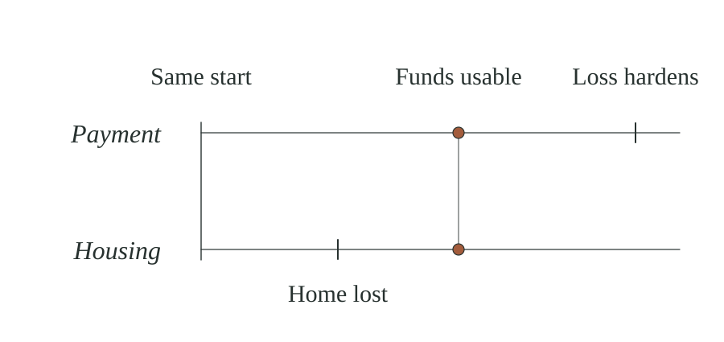

# ME 1.1 working manuscript: Chapters 2, 5, 6, 9, 11 and 12, and the Notes

Draft for Campfire's integration and Mark's editorial decision ([COM #955](https://github.com/markgoodbody-bit/COM/issues/955)). This is the cumulative working text: each chapter edit is carried here once it has been integrated (Campfire c6945568099, c6946950432). It is not a release, and the released v1.0 files are unchanged. The excerpt includes the chapters named above and the Notes. The exact change against the released manuscript (SHA-256 `1315a2c2…`) is in `ME11-WORKING-SLICE.diff`. The file keeps its earlier name so existing links still work. For the full book with all fourteen chapters and the glossary, read ME11-WORKING-MANUSCRIPT.md.

## Changes from v1.0

The Chapter 9 comparison follows two platforms with the same backlog and asks what an independent review can establish before an appeal closes.

1. **Chapter 5:** four changes from `ME11-WORKING-EDIT-CH05.md` at `c9ee3dbb` (Campfire's integration). A paragraph after line 126 names the capability lineage (Sen 1979; conversion factors). A sentence at line 134 adds the test of ordinary reserves. A paragraph after line 146 says contentment is not evidence that a practical limitation has gone, keeping both "never licenses overriding what the person says they want" and Campfire's "choosing a different goal can still be a valid decision". The limits proposal's cut at line 148 is applied.
2. **Chapter 11, shared capability:** one paragraph (90 words) after v1.0 line 434, the library-workshop example, and before line 436, "The workshop becomes fragile…". It separates a learner's skill gained with help, the residents' gain secured by acting together, and the workshop's arrangements that shape both. This is Campfire's proposed paragraph (relay `cbc0c7bb`) with one CC sentence added from Robeyns §3.6, which CC read.
3. **Chapter 11, workshop passage:** three paragraphs (390 words) after v1.0 line 440, covering positive memory in a handover, time returned and durability. From `CH11-WORKSHOP-PASSAGE.md`, with Campfire's correction: "A faster booking form may save staff time by asking participants to upload documents. Count their time as well."
4. **Chapter 12:** v1.0 lines 450–470 replaced by Campfire's integrated text (`CAMPFIRE-INTEGRATED-CH12.md` at `e7b4ffc6`), 812 words, with straight quotes. The numbered source markers are removed; the sources are named in the prose and given in the Notes, following v1.0's convention.
5. **Chapter 12, line 472:** "A routing service" becomes "The routing service", because the new text already introduces routing apps. This is an optional continuity edit, applied here and flagged.
6. **Notes:** a new "Scope and limits" section opens the Notes (from `SCOPE-AND-LIMITS-PROPOSAL.md`). "Sources and authorship" gains this edition's source paragraphs for Chapters 2, 5, 6 and 9, for Chapters 11 and 12, and for Chapter 11's shared-capability distinction (Robeyns).
7. **Notes, consolidation:** three sentences that the new section now states are removed from the retained Notes. They are "A description alone cannot grant rights…" (What the language does), "Professional medicine, law… must not replace" (Values and responsible use), and "The household, library and workshop scenes are constructed for explanation" (Status and evidence).
8. **Notes, status and provenance:** the inherited DEV4 draft identity and QA claims are replaced by the current working status (Campfire, `29fa56d7`), with the edited chapters listed above. The adjacent source history is explicitly historical; no old layout receipt is presented as verification of this revision.

9. **Chapter 6:** the library passage shows measured time and an occasion to learn. The prevention section cites adaptive planning on lead time. The two repeated qualifications listed in the scope proposal are cut.

10. **Chapter 9:** the shared-source witness example and scoped design-effect illustration are integrated, with disagreement retained for checking rather than treated as proof of independent errors. Two repeated intention caveats are removed while the local predator-position qualification remains. Its Notes distinguish Kish, Kohli and Kim et al.

11. **Chapter 2:** one paragraph (159 words) after v1.0 line 66. It ties when to recheck a record to how fast the thing it describes can change, citing Parr and Friston (2017) as an analogy from a model of visual search and limiting the parallel to pace. It explicitly declines the model's lower attention to unclear signals as a rule for people: improve the conditions for giving a hard-to-hear account before deciding how much it can carry.

## Left for the editor

- The other cuts in the limits proposal fall in chapters not yet edited; each still needs reading in its paragraph.
- The historical Chapter 7–8 items (floor versus tradeable harm; chosen narrowing) are not yet chapter edits. Chapter 6 took the lead-time and *kairos* sources; the map's estuarine cost-and-time suggestion for Chapter 6 was not used.

---

*[The opening note and Chapter 1 are unchanged from v1.0 and omitted from this excerpt.]*

# 2. The Window We Have

An **aperture** is a particular way of finding something out. A window gives a view of the garden while a thermometer supplies information about temperature; neither method answers every question. People and organisations likewise encounter the world through senses, records, instruments and other people's accounts, which can disagree without one of them being dishonest.

An **account** is what someone preserves or communicates about an event or situation: a note, map, photograph, memory or model. Its usefulness depends on what was included, the circumstances in which it was made and what somebody now wants it to establish. A map that accurately shows the streets may be silent about whether a lift is working today.

You look at the glass. You see its shape and perhaps moisture on its surface. From that you infer the water may be cold. You do not know the temperature unless you obtain more information. Someone who tastes it, measures it or recalls filling it may contribute something different. None has the entire world in one glance. In this situation the observation, the inference and the unknown all have different jobs. Confusing them would make an account appear more certain than its evidence warrants.

A useful account therefore says what it describes, who made it, when the information was gathered, and which claims are observed, reported, inferred or still unknown. We need not distrust every record. We need to know how far it can carry us.

A city map may guide a visitor from a station to a hospital perfectly well while saying nothing about a broken lift or the cost of the journey. The visitor needs the map, but may also need a current accessibility report and reliable information about the service they are seeking. The same caution applies to human testimony: a child can be certain about hearing a frightening noise and uncertain about what caused it. Respecting the limits of each account allows its useful evidence to survive.

A photograph of the glass remains a record of the moment it was taken. Its age becomes important when somebody uses it to say what is happening now. If there is credible reason to suspect that a consequential condition has changed, or the present claim lacks a suitable warrant, a fresh check may be needed. Consequential to whom, and for which question? The person setting the scope should say, and people affected by the decision need a way to point out important omissions. The library's poster may have been reliable for months and still be wrong about an unexpected closure tonight.

Call this **possible staleness**: an account may no longer support the use someone is making of it. There is no universal age at which a record expires.

*Credible consequential change, or no adequate warrant for an important present use → check the claim or keep the uncertainty visible.*

The arrow states a practical connection between an important current uncertainty and the work of checking it. Rechecking every old record would waste time; relying on an old record despite a credible relevant change can be equally careless. A fresh observation, a genuinely independent source or a person able to check the actual door may resolve the question. Two copies of the same dated notice offer no additional independent witness, however neatly they have been preserved.

How soon a record needs checking depends on how quickly the thing it describes can change: a bus timetable during roadworks goes stale faster than a map of the river. Thomas Parr and Karl Friston draw a similar line in a mathematical model of how the eyes search a scene. They separate a world that is changing from a view that is merely unclear, and in their simulations the eyes return sooner to places that change faster. Their model describes visual search, not people or institutions, so the parallel is only about pace. Another feature of the same model should not travel: it looks less often where the view is unclear. With people that would be the wrong lesson. An account that is hard to hear, because it comes haltingly, in a second language or from someone who is afraid, may hold exactly what is missing. Improve the conditions for giving it before deciding how much it can carry.

A partial view can also be an opening into learning. The child by the window decides a seed has failed because nothing green has appeared. Every morning they disturb the soil to see whether it is growing. Another person, who has watched several seasons of seedlings, knows that digging it up each day may prevent the very result the child wants. That person has *another view*: an account from a place and history the child does not yet share. The child can listen to the advice, test it and perhaps learn a better way of investigating the seed without simply repeating an adult's answer.

A neighbour explains how to judge moisture by touching the soil beside the seed, and agrees to check it again next week if nothing emerges. There is a way to test the account without destroying the thing being watched. It takes more than two perspectives for learning to occur: the other account must be relevant, reach the child in a form they can use, and survive an appropriate check. The seed may still fail. Even then, the child has acquired a better question and a less destructive way to investigate it. No one has thereby obtained authority over the child's pot or mind.

The neighbour's advice does more than supply another opinion. It gives the child a method that can be tried without destroying the seed, together with a sensible time to check the result. That can enlarge the child's ability to learn from the next attempt, even if this seed never grows. Another person's knowledge becomes especially helpful when the recipient can understand, test and, when necessary, reject it.

It matters to separate access from permission to disclose. A neighbour may know why someone missed work without having permission to publish it. A nurse may have access to a medical record for treatment and no authority to put it on a public website. A missing public detail is not necessarily a missing fact; withheld is not false, and private is not deceptive. We should keep the account honest without demanding more exposure than the task justifies.

*[Chapters 3 and 4 are unchanged from v1.0 and omitted from this excerpt.]*

# 5. The Road That Exists and the Road You Can Take

A **route** is a way in which a particular result might be reached from present conditions. Seeing a way forward is weaker than being able to take it: the person needs sufficient information, practical resources, permission where legitimate, and time. A road shown on a map may be real without being usable for the person who wants to travel along it.

A library across town has the book a student needs, and the map shows a straightforward journey. The student still has to fit that journey around the bus timetable, the cost of travel and any work or care commitments. A step-free entrance may exist yet be locked when they arrive. The map remains accurate about the street, while the claim that this student can borrow the book needs more evidence.

This gap between having something and being able to use it has a history outside this book. In his 1979 Tanner Lecture, the economist and philosopher Amartya Sen argued that giving people equal goods can leave them far from equal in what they can do, because the conversion of goods into capabilities varies substantially from person to person. Writers in the capability approach that grew from his work sort the differences into personal, social and environmental conversion factors: a bicycle gives mobility to someone who can ride it, where riding is permitted and the roads are fit to use. The student's fare, the bus timetable, their hours of work and care and the locked step-free entrance are conversion factors of exactly this kind. This book keeps two questions beside that tradition: whether the route works in time for the result that matters (Chapter 6), and who controls each condition.

Recall the child who could see the glass but could not reach it on a high shelf. The adult controlled its placement, the child lived with the practical result, and the observation that water was present did not make it accessible. The library creates a related separation without reproducing the family relationship. Trustees or managers may set opening hours, a contractor may control an entrance, a bus operator determines the last connection, and staff must keep the building usable. The student experiences what those arrangements make possible together. No single actor need have planned the student's difficulty for it to arise.

It matters which part is being examined. A printed timetable is an **account** carried to the visitor; seeing that an entrance is locked is an **observation** through an aperture; the locked door itself constrains the **route**. These are connected but different things. If a notice promises accessible entry and a broken lock prevents it, updating the notice changes what people know, while repairing the lock changes what they can do. The distinction is the same one we met with the water glass, now carried across people and institutions through identifiable connections.

The journey is **approachable** when the student can begin it. Calling the book **reachable** is a stronger statement because it requires a feasible way to obtain the book within the time that matters. Where the evidence covers only part of the journey, the honest answer is uncertain. A rule that prevents entry belongs in the account as a real constraint; whether it is justified remains a question for those with the relevant standing and authority.

A possible route is not necessarily a usable one. A published path may exist while the person lacks a bus, money, safe access or enough time. The practical question is whether *they* can travel it. A second test asks whether someone without unusual money, stamina, expertise or contacts could travel it too. A route that works only for people with those reserves is not yet a route for everyone it is meant to serve.

Difficulty can also be made from the join between otherwise defensible rules. The transport operator wants an advance booking, the library asks for an identity document, the accessible entrance requires a staff member to open it, and the complaint team accepts only an online reference number. Each step may have a reason. Together they can make the journey unusable for a particular visitor. The institution cannot answer that problem simply by pointing to the correctness of each step in isolation. Somebody has designed or maintained the categories, hand-offs and permissions, even where no one designed the entire maze. Complex work in medicine, finance or public services often needs specialist safeguards; the answer is not to abolish necessary complexity. It is to ask whether the organisation can carry more of its own map, pass the relevant evidence and clock between its parts, and give the visitor one usable route to someone able to help. The person encountering the failure should not have to become an expert in the entire institution merely to discover where its responsibilities meet.

Sometimes no route was offered in the first place. A form may have categories for approved and rejected applications, but no category for people who never encountered the invitation, lacked the language or technology to apply, or were excluded from the target group before a file existed. **A missing record of refusal is not evidence of a fair opportunity.** The boundary of the institution's measured applicants is not necessarily the boundary of affected people. The unheard person may be invisible to the very system intended to demonstrate that access was open.

Even where a path exists in each version of the world we are considering, a person may not know how to select a safe one. Imagine two streets that look identical from the corner. One is open beyond the bend, the other blocked. In one possible arrangement the left turn succeeds; in the other, the right. An all-knowing map of both arrangements contains a successful route for each. But the traveller cannot distinguish the arrangements yet, so the evidence does not establish a **single observation-based policy guaranteed to succeed across both**. An arbitrary first turn might succeed in one. That is weaker than a warranted plan for either uncertain situation.

A sign placed before the corner can change what the traveller knows. A bridge can make a route feasible whichever street is blocked. These are not the same intervention: one improves information, the other changes the available world. Sometimes the smallest helpful thing is a better account; sometimes it is a new road; sometimes it is giving an already capable person the resources and permission to carry the work. The distinction makes positive construction more precise rather than less ambitious.

Yesterday's notice of the library hours may still be correct. If the accessible entrance has closed, however, the student's intended journey changes even while the printed opening hours remain the same. A fresh observation can alter what the student knows, although it will only help if the information reaches them while they can still do something with it. The institution may have to change the entrance arrangements rather than merely update the notice.

A **supported prospect** is a future that someone has a credible way to approach or build, given conditions we can identify. A child learning an instrument may need a teacher, somewhere to practise and an affordable instrument. A community workshop may let several people acquire skills together. Neither result is guaranteed; both have a firmer basis than an encouraging slogan.

A supported prospect is also not measured by how content someone says they are. Sen described a person with a disability who, through a cheerful temperament or low expectations, reports being as satisfied as anyone else while still unable to move about freely. Contentment of that kind does not show that a better route was unavailable or unwanted. It never licenses overriding what the person says they want. Contentment alone is not evidence that the practical limitation has been removed; choosing a different goal can still be a valid decision.

Such a prospect does not create a duty to pursue it, to feel optimistic or to endure a programme. An offer labelled voluntary can still place coercive pressure on someone when refusal threatens essential income, housing or care, including support described as *related* to the programme. Return to Chapter 3: who controls the terms, what does refusal really cost, and does the person have a safe way to challenge the decision? Pressure does not automatically invalidate every condition; the legitimate rule, protective duty and proportional response need their own grounds.

A road that can be used today might close tomorrow. Another road can become possible through learning, cooperation or public investment. We can now ask better questions than whether an option appears somewhere in a policy document. Is it known to the person concerned? Can they take it without surrendering something they have not agreed to give? Is it maintainable? And, once they begin, can anyone carry the action all the way to its needed effect before the relevant future closes?

By the time the student checks the notice and boards the bus, the closing hour is drawing nearer. Whether the journey succeeds now depends on more than the existence of a route.

# 6. The Clock and the Hand on the Door

A **clock** lets us compare the time needed to act with the time available before a particular result can no longer be achieved. It needs a starting event and a clearly defined end. The person who controls an opening hour or an inspection schedule often occupies a different position from the person whose opportunity closes during the wait. Their control and exposure must be described separately.

The student knows the route to the library, has enough money for the bus and is allowed to leave. Those conditions make the journey possible, but the visit can still fail if the library closes before the student arrives. The relevant effect is obtaining the book, not merely setting out with the right information.

Suppose the library closes at five and the student reaches it at half past five. The ticket and address were both valid, but neither could keep the door open. A visit tomorrow is possible, though it cannot provide a book for today's class. Both time estimates should begin when the student sets off: how long until they could reach an open door, and how much time remains until closing? A different starting point for either estimate would spoil the comparison unless a supported conversion makes them comparable.

Other paths become stronger through time. A musician practises until playing a difficult passage no longer depends on a lucky attempt. Neighbours build trust by keeping small promises. A repaired bridge is maintained so it remains usable in future storms. The same passage of time that narrows some opportunities can deepen capability and make other opportunities more dependable.

**Hardening** is what happens when undoing a particular loss grows harder, more costly, possible for fewer people or impossible in a comparable form. A missed lesson cannot be attended yesterday. A worsening illness may narrow treatment choices. But time can also strengthen things: practice makes a skill more dependable, and kept promises can build trust. That strengthening is **consolidation**. Neither the passage of time nor the fact of closure decides whether an outcome is right.

The library offers half an hour of help with its catalogue. A student who has tried it can say where they got stuck. A librarian has time to sit with them, and the student wants to try again. That visit can give them a skill they take to the next library. Keeping some staff time free and giving people a choice about how to ask can make such openings more common.

David Ing and Gary Metcalf draw on the distinction between measured time, *chronos*, and a favourable occasion for an activity, *kairos* (see the Notes). Both questions matter for the student. How much time is available? What can they do with this visit?

To see if a particular loss can still be prevented, compare two times from a common starting event. When will the damage become difficult or impossible to reverse in a comparable way? And when can a particular corrective action actually be completed, given the people, permissions, resources and uncertainty involved? A fast promise is not the same as a feasible intervention.

In the garden the watering instruction had to reach a key holder before anyone could take the can to the plants. In a library, a decision about the opening hours may have to pass through a budget, staff rota, building manager and door system before a visitor can use it. These stages may overlap, wait in queues or send a question backwards for another decision. It would be misleading to add a series of ideal processing times while ignoring an unstaffed handover or the hour at which the door actually opens. We should follow the particular route from a common evidenced starting event to the effect needed by the person exposed to the loss. An organisation's clock is therefore made from connected processes, not just the date printed on its decision.

A timely correction has several stages. Someone must **detect** the relevant change. Evidence must **reach** an actor who can consider it. The actor must **decide** and, where needed, obtain legitimate authorisation. Someone must **execute** the intervention. Finally, the intervention must actually have the **protective effect**. A form being submitted or a work order being approved is not the final effect.

Detection, reporting, authorisation and execution may overlap or need several passes. What counts is the elapsed time until the **protective effect**, supported by evidence about the particular route. A quick acknowledgement can be followed by a delay that defeats the purpose.

When an intervention aims to prevent a specified loss, its protective effect must occur **strictly before** that loss becomes too hard to prevent. We can write the timing relationship as *T(protect, a) < T(harden, a)*, where *a* denotes the action being considered. The strict inequality is necessary for that particular prevention, but a fast action can still fail, be unauthorised or impose an unacceptable burden. The clocks alone decide none of those questions.

In adaptive water planning, Haasnoot and colleagues account for the lead time a new policy needs before the old one ceases to meet its objectives (see the Notes). The same practical question arises when somebody faces a particular loss. When must the work start for protection to reach them in time?

The common starting event is part of the evidence, just as the threatened loss needs a defensible description. A temporary hold can shift the expected time of one loss while creating a new exposure for somebody else, so its effects must be examined together rather than treated as free insurance. When the times or the criterion are contested, that disagreement belongs in the account.

Timing estimates are often uncertain. If the latest evidenced moment for effective protection is earlier than the earliest evidenced moment of the relevant hardening, that supports an open window *for this course*. If the start, endpoint, threatened effect or timing bounds are unsupported, say **UNKNOWN**. One closed route does not close every alternative. Nor does a missed chance to prevent the first loss erase a later chance to mitigate continuing harm. A student cannot attend yesterday's class; help today might prevent next week's absence. Name the new loss and its own clock.

When the relevant timing or evidence remains **UNKNOWN**, people still carry the costs of what happens next. Gathering more information can consume a scarce window, while continuing a practice or placing it on hold may expose different people to harm. The competent decision-maker must consider those courses under the applicable duties, with affected people able to challenge what was assumed. Uncertainty itself supplies neither an automatic order to continue nor an automatic order to stop.

There is a further question about the **default course**: what will change if ordinary procedure continues while nobody intervenes? The organisation may hold the records needed to resolve a claim yet leave the affected person to obtain them; it may set a review period longer than the person's remaining time to act. In that arrangement waiting is cheap for one side and costly for the other. Call this a **strategic unknown**: uncertainty that protects an existing position by letting the ordinary process continue without a named owner of the investigation or suitable protection for those exposed. It need not involve dishonesty or a deliberate plot. The practical test is who can reduce the uncertainty, who is required to do the work, what happens to the affected route meanwhile, and whether temporary protection can be authorised without ignoring risks to others. Where an actor has a relevant protective duty and holds the records or power needed to reduce a material unknown, uncertainty creates accountable work for that actor rather than a licence to leave the burden with the person exposed. The duty and permissible protective response depend on the particular role and domain. An honest UNKNOWN does not make delay neutral or order every activity to stop.

This matters even more when a software service makes hundreds of decisions before a reviewer can examine one. Imagine that a benefits system issues an automatic refusal and offers an appeal that is manually processed after the support period expires. The system may detect a submitted appeal immediately, route it correctly and approve it eventually. Yet the effect arrives after the person has lost the threatened opportunity. Speed of the first stages is not evidence of a timely protective outcome. No invented millisecond threshold is needed to see the failure.

There is a historical contrast between waiting without protection and holding a decision while evidence is examined. In 1960, FDA reviewer Frances Oldham Kelsey questioned the safety evidence submitted for thalidomide and sought further information rather than allowing the application to proceed on that basis. The United States approval did not follow, while reports from countries where thalidomide had been used later documented severe birth defects associated with exposure during pregnancy. The important protection came from a particular combination of medical review, a requirement that the applicant provide adequate safety evidence and the FDA's legal authority not to approve marketing on inadequate evidence. It does not follow that all uncertainty requires prohibition, or that any reviewer can exercise that authority in another domain. The account comes from FDA historical material, not from the illustrative cases in this chapter.

For the person refused support, there may be more than one loss. An eventual payment can restore the money without restoring the tenancy lost while payment was delayed, or the care missed in the interim. Each coupled effect needs its own account. Declaring the money repaid is not proof the threatened future was fully restored.

{#fig:two-clocks width=126mm}

Different paths have different clocks. A late payment may restore money while leaving a missed train in the past. Medicine may require probabilistic estimates rather than a single deadline. When we lack sound timing bounds, **UNKNOWN** is an informative result: it tells the decision-maker where better evidence or an immediate precaution may matter.

Several open windows can also conflict. Suppose three households each need a two-day repair by one crew, with relevant losses hardening before days three, four and seven. Each job could finish within its own window **if the crew were free**. One crew cannot finish all three in time merely because each individual comparison passes. The shared crew, competing tasks and ordering must be assessed together; a second crew or a safe temporary measure may change what is feasible. If one path must wait, the priority requires a decision made under legitimate authority and open to challenge. Neither a queue nor the timing inequality can make that decision by itself.

A hold creates a second exposed party and its own urgency. Delaying one household's work may place another in danger, while temporarily stopping an automated refusal may require an interim payment. We must account for both rather than pretending caution has no cost, or assuming that the two effects carry equal moral weight.

The next issue is who has the means to change the journey and who must wait for them.

The library's evening hours are set in an office that closes at four. The people choosing them have a budget, staff rotas and a building to secure. They can ask for another month's figures before deciding whether to extend the hours. For a student whose assignment is due on Friday, that month is not available. The student can explain the deadline, but cannot change the rota or keep the building open.

The office has reasons to wait. The student has reasons not to. The important difference is not that one side knows everything or that the other knows nothing. It is that they can do different things, and do not carry the same consequences while the question remains unsettled. The people who set a clock may not feel it run. The person who can describe a closed route may not be able to open it.

The path and its clocks have authors as well as observers. The institution chose a library closing time, the office chose a reporting period, and the student has a deadline set elsewhere. If a report uses the office's monthly window as though it were the student's usable time, the comparison silently privileges one position. We must say whose start point, end point and affected future the claim uses.

The same relation can appear where more is at stake. A tenant reports damp spreading behind a child's bed. The landlord can arrange an inspection and authorise repairs. The tenant can send photographs, move the bed if there is space, and try to reach someone who can act. Neither knows the full cause yet. But the child sleeps in that room while the question stays open; the person deciding when to inspect does not.

The request can be recorded as received without changing those positions. Another photograph may improve the account held by the landlord while leaving the tenant's capacity to protect the room much as it was. More information and more control are not the same change. If an inspection is declared 'in time', ask in time to prevent **which loss**: continued exposure, lasting damage or another specified effect? The landlord's file-closure date is not automatically the child's protective deadline. The affected household and competent specialists may challenge the criterion and its evidence.

Consider two flats sharing a leaking wall. The upstairs owner contacts a managing agent and a contractor reaches the defect promptly; the downstairs tenant reports damp through a form and receives a case number, followed by requests for photographs while a child's room remains affected. This is a constructed comparison, not a factual report. The physical cause may be the same, but the two routes differ in who can reach a decision-maker, who holds the records and who carries the cost of waiting. If the tenant moves before an inspection, the complaint may close because the tenancy ended, not because the wall or the consequences were repaired. Counting both cases as processed would conceal precisely the difference a useful account should reveal.

The library may genuinely need staff and the landlord may need specialist advice. Even so, the positions are different: one actor can commission a change while another lives with the consequence. We can describe that difference from their available actions and the passing time, without guessing anyone's hidden motives.

The same position can carry help. A pharmacist notices a possible problem with a prescription. Instead of asking the patient to carry the query between offices, she contacts the prescriber and keeps the patient informed. Her access and working relationship make a route available that the patient could not readily use alone. The difficulty has moved towards somebody with the means to carry it.

The person who chooses a timetable may be insulated from the consequences of delay. That is why a credible account asks who can alter the route, who lives with the result and who benefits from keeping an arrangement in place, compared with a plausible alternative. A landlord might benefit from postponing an inspection, but that observation is not proof of malicious intent. Equally, an institution cannot independently certify its own claim that delay is necessary or that a route is closed. Its reasons and evidence need a usable path for challenge.

*[Chapters 7 and 8 are unchanged from v1.0 and omitted from this excerpt.]*

# 9. What Can Travel Back

A **witness** can be a person, record or instrument whose particular way of knowing supports a later claim. A **correction route** is a practical path by which relevant information can reach somebody with both the means and the legitimate authority to change a decision, process or effect. The route also needs some way to find out whether that change happened. Neither the existence of a report nor its arrival in an inbox completes the journey.

At the end of the first two evening openings, the library manager receives a report that thirty people attended. The number may be correct, and it gives the board something useful to examine. It cannot tell the board whether the visitors who most needed the new hours could reach the building.

The figure gives the board a useful indication of attendance, but leaves out why people who needed the hours may not have arrived, whether the last bus was reachable, and what the staff experienced. It is a record of visits, not yet an account of whether the change achieved its purpose.

A visitor writes a note: the building was open, but the accessible entrance had already been locked. A staff member reports that the proposed closing time conflicts with a scheduled bus. A student says the extra hour made it possible to finish an assignment. These are not the same kind of testimony. Each is limited, and each can matter.

Suppose the visitor photographs the locked entrance. The library's door system logs the time it was secured. A third person remembers seeing someone unable to enter. If the photograph and log were retained independently before anyone knew there would be a dispute, they may support a stronger reconstruction than either alone. Even then, the evidence needs interpretation. The door could have been locked for an emergency. The photograph may not show another available entrance. The visitor might have been unable to use that other entrance. The competing accounts need to be allowed to meet.

Two records can appear independent while relying on the same broken sensor, shared clock or source report. Witness independence therefore depends on the mechanisms by which information was obtained, as well as whether anybody copied another person's conclusion. The specific failure being investigated determines which sources could genuinely corroborate each other.

Vadym Chernets gives the plainest version: ten witnesses who all watched the same security recording offer ten statements but one observation. He makes the point quantitative for several AI systems trained on overlapping material, using a standard design-effect correction from survey statistics. Under that simple model, when sources share their errors, their agreement adds far less than their number suggests, and adding more similar sources soon stops helping. The model's assumptions are strong, and it is not a rule for counting witnesses everywhere. That makes disagreement worth keeping visible: it can reveal claims or reasons that need checking.

The board may point to a rule requiring staff to check the entrances before closing. That rule matters only if the check was carried out and could have detected the problem at issue. An inspection of the main door will not establish whether the accessible side entrance was usable; three separate staff records cannot repair that blind spot if none inspected it. The distinctions are practical: **a check specified, a check performed and a check capable of finding this failure** are different claims, and none alone constitutes a remedy.

**Custody** is the practical history of who held a record, who controlled its copies and clocks, and what might have changed. A timestamp records what a particular clock showed; a checksum can support evidence that particular bytes remained unchanged. Neither proves the event's truth, and three files repeating one witness are not three independent accounts.

Custody matters because records can be altered, deleted, exposed or used against the person who created them. A person in a precarious job may have strong evidence of a dangerous practice and good reasons not to place it in a manager's public folder. A person seeking medical care may need a confidential channel rather than a public accusation. A child cannot be made responsible for building an evidence archive about a situation adults should address.

It helps to distinguish access from authority to disclose. The library may possess security recordings without having the right to publish every visitor's movements. A file may be readable on an open website because somebody uploaded it, while its presence there says nothing about lawful or ethical reuse. Privacy is not dishonesty. Withholding a fact does not make the fact false or absent. A witness can support correction without becoming an excuse for universal surveillance. Technical ability to inspect a record is not authority to inspect it. A legitimate reviewer must still justify the purpose, relevant scope, permitted access, retention period and any onward disclosure, with safeguards and challenge proportionate to the risk. Need for one observation does not entitle anyone to an indefinite view of a person's life.

If the library changes the closing procedure, it should preserve enough of the reason for later staff to understand it. But it may not need to preserve the student's full identity or the visitor's unrelated movements. Responsible memory is purpose-bound, not a hunger for every available detail.

An adversarial arrangement may have a complaint link but make it dangerous to use. A worker who has seen retaliation may reasonably refuse to send a signed report. An institution may withhold the only log or alter its clock; it may demand a category the affected person was never offered. Those are describable route conditions. Protecting a private witness, finding a lawful independent receiver or admitting there is no safe effective path may be more truthful than counting the feedback form as an accomplished correction.

The manager answers, 'We have taken this seriously.' It may be sincere, but the accessible door remains locked. The decisive question is whether the information can reach someone entitled and able to change the process.

A record of a concern is not a remedy, and receiving feedback is not yet being answerable. **Answerability** needs a sufficiently safe, usable route to someone responsible; genuine consideration of relevant evidence; and a way to challenge the decision. A reasoned, legitimate refusal may be an answer. A rubber-stamped dismissal, a dangerous complaint channel or an appeal no one can effectively use is not.

Even whether this route counts as safe and usable is an assessment. A department cannot certify its own answerability merely by saying it has a form. Ask whose experience of access was tested and how someone can challenge the result, especially when the department controls the evidence. The safety of a route may remain **UNKNOWN**. A fair process can still produce a substantively wrong decision; the two judgements must not be confused.

**Triage** means accountable allocation of finite review capacity. Urgency, plausible risk, available evidence, relevant duties and who can obtain missing information should guide preliminary assessment, investigation, referral, immediate protection or reasoned closure. An affected person may be unable to obtain records controlled by the institution; that gap is not itself proof the claim lacks merit. As in Chapter 6, ask who controls the evidence and who carries the risk while uncertainty persists. Categories, priorities and refusals require proportionate avenues of challenge; there is no unlimited entitlement to investigation, but an unsupported rubber stamp is not an answer. Where correction is warranted, information must reach someone authorised and able to produce a checkable change. Confidentiality and the person's right to stop remain material constraints.

There must be some route from the affected information to a person or mechanism able to alter what happens. A clerk may be allowed to read the complaint but not to change building access. A senior manager may have the authority and no access to the original evidence. A provider may run the software while the library owns the policy. The strength of the witness alone cannot repair the connection.

Some correction routes fail because the parts are disconnected. Others are kept unusable by design or incentive. An appeal may require the applicant to repeat the same evidence through a channel that loses attachments. A contractor may be paid for closed tickets rather than restored access. A manager may receive every warning yet face a stronger reward for leaving a decision unchanged. A complaint procedure can technically exist while surveillance, retaliation, expense or exhaustion makes its use dangerous.

When a complaint channel is kept unusable, the arrangement warrants a more demanding test. A **predator position** is a repeated benefit drawn from an arrangement that keeps another party unable in practice to understand, challenge, leave or correct it, where the beneficiary controls or materially influences the barrier and could reduce it. The term describes a position, not a permanent identity or an inferred motive. A single difficult form, unequal outcome or necessary safeguard does not establish one: evidence of the maintained barrier, continuing benefit, available alternatives and actual control is needed. For example, a platform may require each harmed customer to submit an isolated complaint while controlling the records that would reveal a repeated failure across customers. If it maintains that fragmentation despite a feasible fair review route, the process can do the work that overt refusal would otherwise do. A person need not be labelled a villain to challenge the arrangement, and the allegation itself remains contestable. We can describe the requirements, response times, lost messages, incentives and harms without pretending to read anyone's mind. If evidence supports deliberate obstruction, it can be named as a further claim with its own witnesses. If a person with power reads the evidence and declines to act, refusal alone does not decide the test: was the concern considered fairly, were genuine reasons given, were applicable duties met, and is there a safe, usable challenge where warranted? A justified refusal can be answerable. A rubber-stamped dismissal or an unchallengeable refusal that leaves an established duty unmet is not. Feedback reaching an inbox proves neither.

Two platforms can show the same backlog. One is short of reviewers, keeps appeal periods open and gives an independent reviewer authorised access to enough related records to check the pattern. The other has the means to offer a joint review and keeps the complaints isolated. Its own records show a recurring overcharge that its rules would repay if the claim were established. Customers can see only their individual cases. Keeping the records apart repeatedly saves the platform money.

A practical change is to let an independent reviewer test the linked cases with access limited to the evidence needed. Keep the appeal open long enough for people to see and challenge the result. Then check whether they can use the route and where the costs fall. A staffing shortage and a profitable barrier can coexist. To establish the position, look for evidence of who could reduce the barrier and what keeping it in place secures.

Imagine a public-service appeal in which a claimant can submit a letter but can never see whether it was received, cannot correct the record used against them, and loses eligibility before any answer is issued. Sending more letters does not establish an effective remedy. A trustworthy description must be capable of saying: **the route was blocked; no effective owner or safe alternative is currently known.** It must also recognise that the affected person may choose not to expose themselves to further retaliation. Describing the obstruction is useful; it cannot force an institution to put matters right.

Nor can an affected person's voice always be assumed to speak for every other affected person. The quiet reader and the music group may disagree about evening use. A worker can challenge an unsafe rota without having authority to decide the entire staffing budget. Legitimate standing and decision power need to be distinguished rather than granted to whoever most convincingly describes a harm.

One complaint may reveal a recurring defect, but different cases are often filed under different names. One visitor reports a locked entrance, another gives up after missing the last bus, and someone excluded before an application opened never appears in the attendance total. Bringing those accounts together can reveal a shared design problem that no single file describes. This is **collective evidence**, not an assumption that every experience is identical or that a majority count settles the judgement. A serious comparison keeps disagreement, rarity, differing consequences and selection out of the records visible. People must also retain reasonable control over what can be disclosed about them; representation can become another gate if an organiser speaks over or exposes the very people whose accounts provide the evidence. Where a recurring failure is supported, the institution should not make each new person start the whole investigation again.

The library adjusts its entrance procedure, keeps a telephone route for people unable to use its app, and names a duty manager authorised to change the closing process. The visitor's bounded observation moves from the front-desk record to the building-access owner, who can check the door setting, then to the duty manager for an authorised instruction. Confirmation that the manager received the report establishes receipt, not an unlocked entrance; a later check during the same evening period is needed to support that result. If the manager does not respond before the next opening, the unresolved route and the person entitled to arrange interim access must be named rather than declaring the case resolved. The first two evenings have become a basis for better work. No one had to know the entire world to achieve it. The board can check the next evening whether the entrance works, and a visitor can contest its report if the problem continues. But a future visitor's improved route does not return the first student's missed class. That remaining consequence calls for another kind of attention. Several partial accounts were able to correct a limited part of it.

A public announcement that the entrance procedure has been reviewed is not the same result. An institution may apologise, train staff and publish a dashboard while the next visitor still finds the door locked. Call this **correction theatre** when the display of answerability improves faster than the conditions it claims to repair. Reviews and training can do real good, so the label needs a test rather than suspicion: which rule, incentive, interface or authority has changed; can somebody outside the failing route check it; what evidence would show that the next visitor still faces the same barrier? A clean closure figure proves that files were closed under the stated rules. It does not by itself prove that the harmful mechanism stopped generating cases, or that excluded people ever entered the count.

Repair needs to survive the original complaint. The changed entrance procedure must reach the next shift, stay usable, and have a responsible owner. An individual case can be closed while the same mechanism still harms the next visitor; those are different outcomes.

The value of the record lies not in how impressive it looks but in what truthful, proportionate change it makes possible.

*[Chapter 10 is unchanged from v1.0 and omitted from this excerpt.]*

# 11. The Things We Make Possible

**Formation** is the gradual development of a capability, habit, relationship or shared arrangement. Attending a class or following an instruction is evidence of participation, while using what was learnt later is stronger evidence of an acquired capability. A new arrangement also needs **maintenance**: the time, tools, money and attention required to keep it available to the people who depend on it.

Over several weeks the child has returned to the pot on the windowsill, checking the soil and noticing the effects of too much water as well as too little. An adult has placed a tray beneath the pot, so that the inevitable mistakes are less damaging, and has gradually needed to remind the child less often.

The child is beginning to care for the plant without constant prompting. That suggests a skill is developing, although successfully looking after a different plant would give stronger evidence that the child could use what they have learnt under new conditions. The adult's contribution matters as well: the tray and the time spent teaching make it possible to practise without turning every spill into a crisis.

{#fig:growing-room width=126mm}

The pot has also become something to enjoy. The child paints it in clashing colours and watches an insect with a friend, and neither activity needs to be justified as preparation for a later achievement. Play and companionship are valuable parts of the afternoons themselves, alongside any practical skill that lasts beyond them.

Formation has carriers and clocks as real as the correction of injury. A person needs occasions to practise, feedback on mistakes, tools they can reach and enough continuity for yesterday's learning to affect tomorrow's attempt. A workshop open only once before its equipment disappears may inspire somebody but fail to sustain a new skill. Regular access, patient teaching and safe correction can build one. The person learning still has agency: help must leave room to refuse, change direction or surpass the teacher.

Learning here depends on more than individual effort. The child sees the plant through a limited view, receives a method from somebody with experience, tests it and makes adjustments. Water, a tray and a place to work carry other people's contributions into that small act. As the child gains confidence, the adult can offer less direct help while remaining available when something goes wrong.

It is worth seeing the difference between protecting an existing opportunity and making a new one. The child could always stand by the window. They could not always care for a plant. The skill is not a new object that can be handed over in one motion. It has been formed through repeated encounters, trial, correction, encouragement and conditions that allowed mistakes without unnecessary punishment.

The same practical issue arises in a bicycle workshop: somebody learns by trying a repair with suitable help, makes mistakes that can be corrected safely and eventually manages a task without the helper's hands. Not all progress is visible on the day of instruction. What matters is what the person can do afterwards and whether the tools, knowledge and time remain available.

People may need protection from immediate injury and room to learn, create, work, play, care and explore. A good arrangement makes those pursuits possible in practice: through usable places, dependable help, time, equipment and freedom to choose. Its upkeep must also be counted.

The library's evening hours are a modest example. A student gains access to a quiet room. Over several weeks, that room becomes somewhere they can study without being interrupted. A volunteer teaches a child how to search for reliable information. A new friendship begins. These are not all consequences that the library can predict, own or claim as its performance. They are possibilities supported by an arrangement whose users may make of it more than its builders imagined.

The arrangement has to be sustained. Electricity and maintenance cost money. Staff need rest. Someone must replace books and repair the lift. The students' gains are not free just because entry to the building is free. A claimed benefit that depends indefinitely on unacknowledged or coerced labour is not an honest description of success.

A library that opens for one evening has created an opportunity. Keeping the service available over a term will take a staffing plan that people can sustain.

Ask who actually bears the maintenance. A library's longer hours may depend on cleaners, carers, volunteer organisers, technicians and night transport that do not appear in the celebratory attendance figure. If their time, consent or compensation is missing, the institution may be shifting the cost of one group's new capability onto people with less power. Maintenance can also be an opening: training a second repairer and handing over a clear guide makes the useful arrangement less fragile. We should describe both the capacity gained and the dependencies that keep it alive. A training programme may produce a skill that decays without practice. A friendship may need attention. A forest restoration project requires care through seasons when the first volunteers have moved away. The future contains the work of upkeep, and the people who will inherit that work deserve a place in the decision.

A constructive decision therefore has its own window of opportunity. A young person who needs a placement this term cannot necessarily use a programme promised five years later. An ecological restoration can miss a breeding season and still provide gains later. In each case, the target, the starting conditions, the time to become effective and the costs of sustaining the gain are part of the proposal. We should not evaluate creation solely by counting imagined future options.

What matters is the capability being formed, the people able to use it, and the conditions that allow it to last. A useful skill can also be misused, so the judgement of its value belongs with the openly stated purposes and affected people introduced earlier.

That question can protect independence without requiring isolation. A student becomes more independent because teachers, public services, tools and other learners were present. A disabled person may gain autonomy through dependable assistance rather than through abandonment. A skilled engineer may depend on colleagues who are free to challenge a design. Mutual dependence is not inherently a failure of agency. Dependence becomes dangerous when one party can withdraw essential help without answer, conceal costs or make refusal impossible.

Experience can alter a person who has harmed others, but an account of how damaging conduct developed does not excuse it or erase the consequences for those harmed. A harmful act is not proof of an unchanging personal essence, and a later improvement is not proof that restoration has occurred. These questions call for responsibility, evidence, protection and a real prospect of change rather than a permanent label.

Care must therefore be distinguished from control. A parent helps a child cross a road and, as the child grows, learns when to let the child cross independently. A carer may know what a patient usually wants and still need to ask what the patient wants today. An AI assistant may provide valuable explanations while its user retains ways to question, learn without it or seek a human expert. The changing needs of the relationship matter more than preserving a fixed image of the helper as always necessary.

**Shared capability** is a usable result created through joined contributions that no participant could currently provide alone. It exists through the joins: skills, room, tools, time, permissions and continuing maintenance. The strength of such a capability depends on how those contributions remain connected.

The library's room may also serve as a place for people to repair things together. A mechanic can teach safe practical methods but has no room suitable for a public workshop; the library has space and a residents' group knows who wants help. With tools, sensible insurance and organisers who can share the work, these contributions could support a regular event. A chair and a broken toaster are easier to bring there than a life story, and somebody learning to repair a bicycle can leave with more independence than if the mechanic simply took it away and returned it fixed.

A learner's new skill, the residents' success in securing use of the room and the workshop's ability to run next Saturday are related gains, but they are not interchangeable. The learner needed help but not a group; the residents had to act together to win the room; the workshop's arrangements shape what both can do. Record each at the level where it occurs. Then ask which opportunities become usable for each person, what still needs maintaining, and whose freedom to leave or disagree might be lost while the group succeeds.

The workshop becomes fragile if one enthusiastic organiser is expected to give up every Saturday without relief. Training another organiser, sharing costs and allowing volunteers to stop without losing essential support help preserve the service and the freedom of those contributing. Shared capability involves people being able to use and sustain what they build, including when one of them needs to leave or choose a different use for their time.

There is a less obvious way for the workshop to lose that freedom. Imagine a company offering enough money for rent and safer tools, provided every participant registers an account, submits attendance and behaviour data, accepts photographs for publicity and gives the sponsor a continuing right to exclude people it considers risky. The offer could genuinely improve the workshop's facilities. It would also make a place where people learn without explaining their private difficulties dependent on giving those difficulties to somebody else. The organiser should ask participants what support they actually want, which information the funder needs for a legitimate purpose, who can use it later and whether essential access survives refusal. 

The group might negotiate limited, non-identifying reporting and independent decisions about attendance; the company might decline those terms. Rejecting a harmful condition does not pay next month's rent, and accepting money is not automatically exploitation. The comparison must keep both the opportunity forgone and the authority over participants that a contract would transfer. **Non-extractive cooperation** enlarges what people can do without quietly making their vulnerability the price of entry.

When a second organiser takes over, the handover needs more than an opening checklist and a count of repairs. The next person needs to know what made taking part possible: the bench by the wall that stays free in the afternoon for anyone who works better unwatched, a session that starts after midday because some people care for a relative in the morning, the diagram left beside the soldering iron, the bus that still runs at closing time, the paid cleaner who keeps the floor safe. None of this needs a file on anyone's private difficulties. It records the arrangement, not the person. With it, the next organiser can see what a proposed change would remove, and which signs would show that something useful has started to fail: fewer afternoon arrivals, or a returning learner asking for help with a job they once managed alone.

An improvement raises a similar question. Suppose a better way of sorting donated parts saves twenty minutes each session. The organiser might use that time to rest, to give a slower learner a second attempt, or to fit in another repair from the waiting list. Each can be reasonable. But "time saved" does not say whose time became free, or who chose what to do with it. A faster booking form may save staff time by asking participants to upload documents. Count their time as well. When an improvement is counted, ask who now has more room, who now carries more, and who decided.

Arrangements that work can also stop working without anyone deciding to end them. A year later the grant that paid the cleaner ends, the last bus is moved earlier, and the afternoon bench becomes storage for donated laptops. No single decision closed the workshop, yet the people it served best begin to drift away. Because the handover named those conditions, the organisers can see what changed. Volunteers who are able and willing take turns with the cleaning, the closing time moves to fit the new bus, and the bench is cleared. Not every condition can be restored, and the people who keep a place going may need to stop as well. The work is to notice what made the place usable and keep that upkeep visible, so that a good arrangement is not lost simply because nobody remembered why it worked.

Imagine a town that decides to build a new public workshop, a greener street and a reliable path to the library. It might be tempted to proclaim an ideal future and silence anybody who points to a cost. It would be wiser to see imagination as the horizon that opens inquiry. The promise is not the proof. Who can reach the new place? Who will maintain it? Which other worthwhile use of the land or money will be lost? Who may leave or disagree? What evidence would make the next design better?

A **supported prospect** is not the same thing as felt hope. A person may feel hopeful about a plan for which there is little evidence, or may feel no hope while someone else can identify a route they have not yet been able to see. Neither observation authorises an outsider to dismiss the person's experience or command them to feel differently. Some futures close irreversibly: a missed relationship, a bereavement or a lost opportunity is not repaired simply because another worthwhile future might later be built. Conversely, knowing no route from one aperture does not establish that no route exists. The useful enquiry is narrower: which future matters to the person concerned, what real means might connect them to it, and what would maintain those means without taking away their freedom to refuse? For a supported prospect to be more than a comforting announcement, look for a first usable step, people and resources able to maintain it, evidence capable of showing when it fails, and permission to acknowledge that the route has closed. The person concerned may still feel no hope; that experience need not be argued away. No supported path creates an obligation to pursue it, remain optimistic or endure avoidable harm.

The child notices that the plant now needs water and reaches for the glass, while the adult carries on with something else nearby. Neither knows whether the next seed will grow. There is room to try.

# 12. When Nobody Holds the Whole Wheel

Some results are made by many people and chosen by none of them. A traffic jam, a rise in rents and a river that floods more often can emerge from actions nobody directed as a whole. This is **distributed causation**. The library has already shown a smaller version: managers set the hours, staff run the building, a contractor maintains the entrance, and students fit their journeys around a separate bus timetable. A missed opportunity can arise from the join even when each local record looks satisfactory.

During the morning rush, rain begins, a delivery van breaks down and roadworks narrow a junction. Drivers react to the queue, to one another and to routing apps that respond to their movements. Moving a school's start time may move the congestion elsewhere. An account needs to show those interactions without pretending that naming every participant explains the whole.

Dave Snowden's Cynefin framework asks us to match our way of acting to the situation. Where a relationship is sufficiently understood, analysis can guide a repair. Where interactions keep changing the pattern, we also need to learn through carefully bounded action. That distinction changes what we can claim from a map.

A recovery vehicle still has an arrival time. An emergency journey still has a deadline. Those clocks matter inside the changing traffic pattern; they do not tell us how every driver will respond. Keep a timing claim attached to the event and evidence it actually concerns. If a route must open before an ambulance can pass, that necessary condition is useful even when satisfying it cannot guarantee arrival.

Snowden's estuarine mapping offers a practical way to examine constraints: assess the effort and time needed to change them, identify what lies beyond the planning horizon, watch for unexpected shifts, and attend to changes that could happen quickly with serious effects. At the junction, relevant constraints include permit hours, signal settings, road capacity and the arrangements under which an app selects routes.

Ask what each arrangement enables as well as what it prevents, and for whom. A bus lane may preserve a dependable journey while limiting another use of the road. Keep useful arrangements working. Where change is possible, name who can authorise and carry it out. Where nobody present can change it, retain the issue and its receiving owner instead of treating it as solved.

Estuarine mapping groups small interventions into portfolios and keeps a direction of travel open to what happens. Applied here, an authorised trial of a signal setting might reveal whether a queue eases or moves into a residential street. Decide beforehand what burden the trial may impose, who will observe it, and who can stop or alter it. Stopping a trial may prevent further damage without undoing damage already done. A small trial still needs a credible account of its possible consequences.

The people affected help tell us what changed. Shorter average journeys can conceal a worse crossing for pedestrians or a lost bus connection. Keep those differences visible when deciding whether to continue. Findings that reach nobody able to act leave the correction route unfinished.

Causal contribution, responsibility and power to repair remain separate questions. An investigation may support a particular causal account; interactions do not automatically yield unique additive shares. Any proposed attribution needs its assumptions and evidence. Even a well-supported causal share does not by itself settle blame. Who caused a loss, who was at fault, who must repair it and who owes compensation can be different questions.

A road authority may control the signals, a contractor may hold duties for the worksite, and a driver may have little influence beyond their own journey. Ask what each knew, did, controlled and owed. Responsibility should follow the relevant evidence and standards. Neither the nearest visible person nor the word "system" should become a convenient substitute for that inquiry.

Sometimes no actor has enough power to repair the failure. Sending the injured person round five departments conceals the problem. This is a **governance gap**: authority, resources and a usable complaint route need to be brought together under an accountable arrangement.

A family's housing may depend on wages, interest rates, landlord decisions, planning rules and law. The useful account carries those interactions while identifying concrete opportunities for intervention and the people responsible for them. It keeps the family's needs and voice present while the wider explanation remains incomplete.

A river is shaped by rainfall, soil, plants, farming and construction. Some of this has no chooser at all. Yet decisions about dams, pollution and flood protection alter the futures of households and habitats. Future generations cannot attend today's meeting, and a woodland cannot file a complaint. Ecological science, public law, indigenous stewardship, democratic institutions and moral deliberation supply knowledge and ways of representing these interests. Carry their findings, disagreements and grounds for authority into the account so that consequential choices remain open to challenge.

The routing service offers suggested journeys to those same drivers. It may reduce overall delay while overlooking a road closure, a disability-related constraint or a hazard on a small residential street. Someone following a recommended shortcut may impose noise and danger on residents who never use the app and may have no direct route to challenge its objectives. Their absence from the optimisation dataset is not an absence from the consequences of the advice.

The software does not need an inner wish to inconvenience them. It acts through data, objectives, infrastructure and human reliance. The people who designed it, deployed it, set permissions and retained logs may have different knowledge and different authority. Attributing everything to "the AI" can hide the people and institutions who decide what it is allowed to change.

Machine speed alters the stakes. A sensor, questionnaire or visible monitoring system can also change behaviour being measured; records are not passive windows in every setting. Asking people for more evidence may help reveal a fault, or create a surveillance risk and encourage hiding. At machine speed, a dubious classification can propagate before a human review can act. A bounded hold needs a defined affected scope, a route to actual stop authority and an understood recovery path; an instantaneous button on a dashboard proves none of these. The same system can also make possible improvements that manual work could never deliver. The interesting question is not whether the machine is good or bad in general, but whether this particular arrangement carries benefits and burdens honestly, maintains a usable way to correct its behaviour and preserves the authority of those entitled to decide.

A person advertised as human in the loop may be asked to approve too many outputs to understand any of them. That may be a ceremonial witness, not meaningful oversight. A reviewer who checked ten ordinary outputs may have **run** a check without being able to detect the unusual failure now causing harm. Another person who can inspect representative and relevant evidence, test a suspected error, and effectively halt the affected class of decisions may provide stronger answerability with fewer clicks. The question is what this particular review could detect and change, not how many approvals were recorded.

Even an emergency stop is not magic. It has a scope, a response time and consequences of its own. Stopping a traffic system may send every driver towards a dangerous alternative. A good stop needs an accountable owner and an understood recovery path. A route is not usable because somebody drew a button on the screen.

Where software can commit consequential decisions across thousands of cases before a person could detect and challenge one, retrospective appeal is not a sufficient **machine-speed brake**. An appropriate arrangement may stage deployment, limit the number or duration of irreversible actions, hold a contested output before it takes effect, preserve rollback capability or provide an independently reachable interruption with genuine authority. The right combination depends on the domain and the harms created by a stop as well as by continuing. If review cannot responsibly operate as quickly as the machine, the design may need to slow commitment or leave a protected interval for human-speed correction. A human name in an approval field does not establish that the person saw the relevant evidence, could recognise the failure or had time and power to prevent it.

At this scale, care becomes a design question as well as a personal one. Does an arrangement let its beneficiaries inspect important advice, decline participation where legitimate, preserve their knowledge if the service changes and reach accountable people when their futures are at stake? Does it unfairly shift costs to less visible entities, including workers, neighbours, non-users and the environment?

An ambitious system can be a genuine gift. It can widen knowledge, create useful work, protect people and help communities coordinate. That possibility deserves exploration. A gift becomes less valuable when accepting it requires surrendering the ability to question what it does.

The road network and the routing service raise similar questions about whose constraints are visible and who can correct a harmful outcome. Their mechanisms differ: one involves physical traffic and public infrastructure; the other adds data, optimisation and automated recommendations. The comparison is useful only if we check those distinct mechanisms rather than presume the same solution will fit both.

*[Chapters 13 and 14 and the glossary are unchanged from v1.0 and omitted from this excerpt.]*

# Notes: Scope, Method, Limits, Sources and Authorship

## Scope and limits

These conditions apply to every chapter. They are stated once here so that the chapters can say what they mean.

**What a description can settle.** The language describes what changed, who could act, which routes were usable, what was repaired and what remains. It does not assign rights, decide moral standing, set priorities between competing needs, or make a remedy happen. Those need the people affected, declared values, evidence and legitimate authority. Where a chapter asks "who can decide", it means whoever actually holds that authority under the law and institutions involved. Controlling an arrangement is not the same as having legitimate authority over it, and existing institutional power can itself be contested.

**Specialist methods govern their own ground.** Medicine, law, safety engineering, scheduling, ecology and other fields have stronger methods and duties. This book's questions help locate where those methods are needed and carry evidence to them. They do not replace them.

**Local claims inside complex situations.** A timing or route claim applies within its evidenced scope. Where an outcome comes from many parts responding to each other, such a claim can stay useful (an ambulance still has a deadline) without forecasting the whole result. There, map constraints alongside causal inquiry, and act in bounded, watched trials whose remaining effects are counted (Chapter 12). Interacting effects do not divide automatically into unique shares; any attribution needs its assumptions stated.

**Arrangements, not motives.** The book describes barriers, incentives, delays and who benefits from them. Unless separate evidence shows deliberate obstruction, those descriptions do not establish anyone's intentions. The predator position (Chapter 9) is defined by what an arrangement does, not by what someone wants.

**Uncertainty.** UNKNOWN is a result, not an instruction. On its own it neither orders an activity to continue nor orders it to stop. It does create work for whoever can reduce the uncertainty and has a duty to (Chapter 6).

**Evidence for this book.** The household, library and workshop scenes are constructed for explanation. The Kelsey and *Challenger* examples come from the official records cited in the Notes. No field trial, peer review or independent test of whether new readers understand it has been established for this edition. Agreement among the AI systems that helped draft it is not independent confirmation.

## What the language does

Mechanical Ethics is an experimental, portable reasoning language for human and AI-assisted inquiry under limited knowledge. Its descriptive vocabulary helps locate changing conditions, boundaries, apertures, accounts, possible and usable routes, clocks, carriers, feedback and achieved effects. It can identify where a question, warning or repair must travel.

The distinctions in the chapters are not a complete mathematical system. **A ≠ B** preserves two roles that should not be confused; it does not imply numerical inequality, or that A and B can never coincide in one case. A compositional arrow expresses a conditional route with missing premises still to be checked. The timing relation is about a specified threatened outcome and actual protective effect under supported clock bounds; it is neither a guarantee nor a moral permission. When a necessary premise is unknown, the result stays unknown.

## Values and responsible use

Judgements about harm, benefit, standing, priority, privacy and legitimate intervention require declared value sources and authority. The same mechanism can serve different purposes. A complete account should say who selected the affected scope, comparator and horizon, who can contest the choice, and which relevant people or entities may have been left outside it. Naming these inputs makes debate possible; it does not prove that the decision was just.

A record can support an investigation without being a lawful public carrier. Personal refusal, private information and witnesses' safety remain consequential. Case closure may coexist with unrepaired loss or an unchanged mechanism. A constructed opportunity may have hidden costs or collapse without maintenance. These distinctions belong alongside particular choices in practice, not as automatic objections to every constructive possibility.

The Chapter 10 residue ledger is an **illustrative account design**, not an existing public-service reporting standard. Any real implementation would need a legitimate purpose, proportionate data collection, suitable retention and access controls, an appropriately authorised reviewer, safe challenge, and an accountable means of acting on the record. Its fields should retain observation, inference and unknown separately. There is no universal conversion of a missed opportunity into a numerical moral debt, and evidence that a particular ledger works has not been supplied by this book.

## Status and evidence

This is a working slice for Mechanical Ethics 1.1, prepared on 17 November 2026 from the released ME 1.0 book. It contains Chapters 2, 5, 6, 9, 11 and 12 and the Notes; unchanged intervening material is omitted. The revision adds source engagement, restores selected meanings from earlier drafts and consolidates repeated qualifications while preserving the existing teaching order.

This text is for editorial integration and Mark's decision. The accompanying diff records its changes, and the released source remains unchanged. The inherited illustrations remain provisional. The limits of the evidence for the book are stated under Scope and limits above.

## Sources and authorship

This working 1.1 revision is **AI-assisted prose for editorial integration**, not a finished literary text authored or accepted by Mark. Mark originated Mechanical Ethics and retains editorial, rights and release decisions. The 1.0 source grew from the recorded clean-sheet kernel-first research route through PR70–PR75. The accepted structural source in that ancestry is `research/kernel_first_human_20261014/THE_MOVING_GROUND_RC3A_20261015.md` at blob `85f213b3d4d954ac0bc1093c6de16cd5441b4e97`. RC1, RC2, RC3, RC3A, DEV1, DEV2 and DEV3 remain separately preserved. The earlier DEV4 edition was revised in response to Mark's authorial direction and a NotebookLM-generated discussion, *Scaling Mechanical Ethics to Institutional Systems* (transcript supplied 15 October 2026). That synthetic discussion offered useful editorial hypotheses, not independent empirical confirmation or a two-person expert assessment. The earlier draft ancestry, source hashes, editorial changes and layout checks were recorded in their accompanying review packages. This slice's diff records its changes. No independent novice comprehension or full specialist review of this specific edition has been established.

Released Mechanical Ethics **v0.8.0** and TRACE **v0.4.0** remain separate, unchanged sources of concepts. Their existing author notes, rights, diagrams and technical materials are not transferred as authority to this draft. Later research contributions by Claude Code and Codex informed the conceptual path, but their involvement does not validate this text. No release, protected merge, website publication or external endorsement follows from the existence of a readable book.

The v1.0 preservation pass re-read the complete released v0.8.0 human reader alongside DEV4 and restored a limited set of its substantive tests: meaningful exit, costly complexity, strategic uncertainty, the predator position, collective evidence, correction theatre, non-extractive cooperation, hope and the safety and limitation boundaries. The paired-flats and funding scenes are constructed illustrations. For Kelsey, see the US Food and Drug Administration, *Frances Oldham Kelsey: Medical Reviewer Famous for Averting a Public Health Tragedy* (FDA History Exhibits), https://www.fda.gov/about-fda/fda-history-exhibits/frances-oldham-kelsey-medical-reviewer-famous-averting-public-health-tragedy. For *Challenger*, see *Report of the Presidential Commission on the Space Shuttle Challenger Accident*, Volume I, Chapter V, *The Contributing Cause of the Accident*, especially printed pages 82–85 on the decision to launch, https://www.nasa.gov/history/rogersrep/v1ch5.htm. Neither example turns uncertainty into a universal mandate to stop or historical analogy into proof of every institutional failure.

**Chapter 2 in this working edition.** The point about the pace of change draws on Thomas Parr and Karl J. Friston, "Uncertainty, epistemics and active inference", *Journal of the Royal Society Interface* 14(136): 20170376 (2017; open access under CC BY 4.0, https://doi.org/10.1098/rsif.2017.0376), sections 1, 3 and 6, read on 17 November 2026. Their result concerns simulated visual search. The chapter uses it as an analogy for when to check a record, and does not adopt the model's lower attention to imprecise signals as a rule for listening to people.

**Chapter 5 in this working edition.** The distinction between having goods and being able to use them follows Amartya Sen, "Equality of What?", Tanner Lecture on Human Values, Stanford University, 22 May 1979, section 4, "Basic Capability Equality" (https://tannerlectures.org/documents/sen80/, accessed 17 November 2026), including the example of contentment that hides a lack of basic capability. The three kinds of conversion factor and the bicycle example follow Ingrid Robeyns and Morten Fibieger Byskov, "The Capability Approach", *Stanford Encyclopedia of Philosophy* (substantive revision 17 April 2025), sections 2.2 and 2.3. The test of ordinary reserves recovers this book's own earlier draft, the unpublished *ME Final Eight* raw source (4 June 2026), Book II, "From Diagnosis to Constraint".

**Chapter 6 in this working edition.** David Ing and Gary S. Metcalf discuss chronos and kairos in [*Reframing Systems Thinking for Systems Changes*](https://coevolving.com/pubs/2024_JISSS_v67_a4154_ReframingSystemsThinkingForSystemsChanges.pdf) (2024), in the paragraph on the nature of time in (con)texturalism-dyadicism. They cite Orlikowski and Yates (2002, p. 686) for the distinction. The catalogue example shows how a person's occasion to act can form within a measured window. Marjolijn Haasnoot, Jan H. Kwakkel, Warren E. Walker and Judith ter Maat, [*Dynamic Adaptive Policy Pathways*](https://ris.utwente.nl/ws/files/247793059/Haasnoot2013dynamic.pdf) (2013), section 5, connect policy tipping points with the lead time needed for an alternative. Chapter 6 identifies the person affected and the specific loss when applying its own timing comparison.

**Chapter 9 in this working edition.** The point about witnesses who share a source draws on Vadym Chernets, "Agreement Is Not Independent Evidence: Auditable Multi-Model Synthesis Without an API" (updated 18 October 2026; version of record SSRN 7390698, DOI 10.2139/ssrn.7390698), sections 1.1 and 5, read on 17 November 2026. The example of ten witnesses and one recording is his. He credits the design-effect arithmetic to Leslie Kish's survey-sampling work (1965) and its application to a panel of AI judges to Kohli (2026); he cites Kim et al. (2025) for evidence of correlated errors across models. Those earlier sources were not consulted for this edition. The model assumes errors that are equally correlated between sources; the chapter uses it as an illustration, not as a general rule for weighing testimony.

**Chapters 11 and 12 in this working edition.** Chapter 12's account of complex situations draws on Dave Snowden's Cynefin framework. The Cynefin Company's overview, "The Cynefin Framework" (https://thecynefin.co/about-us/about-cynefin-framework/), supports matching action to context. The Cynefin wiki page "Cynefin" (https://cynefin.io/wiki/Cynefin, "How it Works / Domains") distinguishes ordered systems, where cause and effect are clear or can be found by analysis, from complex systems that can be understood only by interacting with them. The practical steps for examining constraints follow Snowden's "Estuarine mapping first edition" (The Cynefin Company blog, 7 October 2022, https://thecynefin.co/estuarine-mapping/, outline steps 1–7): the effort and time needed to change a constraint, what lies beyond the planning horizon, watching for unexpected shifts, attention to fast changes with serious effects, and portfolios of small interventions with a direction of travel. All three pages were accessed on 17 November 2026. The ambulance and deadline distinction, the road trial and the participant-level account are this book's own illustrations; the sources give no evidence that such a trial would work.

Chapter 11's handover passage recovers meaning from this book's own earlier drafts rather than adding a new idea. The unpublished *Mechanical Ethics Book v0.1: Value Spine* (27 June 2026), §12.2 "Institutions as Memory" and §12.7 "Maintenance, Stewardship, and Decay", asks institutions to remember what kept a route open as well as what went wrong, and treats maintenance as the work that keeps correction possible after attention moves on. The unpublished *ME Final Eight* raw source (4 June 2026), Book II, including its note "Time Returned Must Not Hide Burden Routing" and Volume 6, "Stewardship Under Constraint", asks who did the work before and after an efficiency gain, and whether surplus becomes buffer or is recaptured as throughput. The workshop's details, an afternoon session, a bench by the wall and a diagram beside the soldering iron, come from the Saturday Workshop interlude in the released v0.8.0 reader.

Chapter 11's distinction between a skill gained with others' help and a gain a group has to act together to secure follows Ingrid Robeyns, *Wellbeing, Freedom and Social Justice: The Capability Approach Re-Examined* (Open Book Publishers, 2017, CC BY 4.0, https://doi.org/10.11647/OBP.0130), section 3.6, "Collective capabilities". Robeyns treats capabilities that need collective action as a subset of personal capabilities, and warns against calling a social structure that shapes capabilities a capability itself. Section 4.6 distinguishes treating each person as the unit of moral concern from explaining society as nothing but individuals. "Shared capability" in this book describes joined practical provision; it does not by itself settle that debate or establish a group's moral standing. Both sections were read in the openly licensed LibreTexts republication of the book, accessed 17 November 2026.

## Figure 1: text equivalent and provenance

Two timelines share one declared starting event. Both mark the same point at which funds actually become usable, with a thin vertical guide aligning it across the tracks. In the first, that effect occurs before one specified payment-related loss hardens; in the second, the home has already been lost. The relative positions are hypothetical, and no numeric durations or observed case outcomes are claimed. Administrative acknowledgement is omitted because it is not the protective effect. The figure illustrates a strict timing comparison for one particular loss; it does not settle how likely the intervention is to work, whose claim is justified, or whether a hold should occur. The original editable source is Codex’s proposed *Two Clocks v3*, draft ME PR78 at exact head `aa421cdfc30750951372d39579fc72c6487c9deb` (Git blob `af2d967a6d1ff80d57b6eca61c4fbc7dcf5529a0`). Its integration in this book is provisional and subject to Mark’s final art-direction decision.

## Figures 2 and 3: text equivalents and sources

**Figure 2, Who draws the map?** An assessor is linked to the outline of a page that compares opening hours with the current timetable. The page is labelled *Selected account*: it marks the boundaries of a report, not the world. A visitor's missed last bus appears outside the page, and two different routes meet at a point labelled *Review*: one from the selected account and one from the visitor's challenge. The lines end there without approval, rejection or promised remedy. The drawing is a hypothetical relationship, not evidence that a real challenge procedure is safe, available or effective. A competent receiver, appropriate authority and usable recourse would still need to be established. Original editable companion art, draft ME PR79 head `fc3e3db8c1dabc4846b3f5c28ef66a2899d36436`; illustration SHA256 `527ab34e0e4b8214ab65bdfdbd070291fd114fecbf743a09ec3e69a343ab58ab`. Proposed placement in Chapter 8 is provisional.

**Figure 3, The Growing Room.** Three small drawings revisit a child, window, glass and pot. The first shows the child looking at a planted pot. In the second an adult offers help, a sprout is visible and a tray catches spills. In the third, the original plant and tray remain, a different plant is nearby and the adult is not shown. A line beneath the scenes reads *Someone keeps the room usable.* The illustration represents possible noticing, practice and a different task, without proving that the child has learnt, consented or become independent. Learning and the fairness of continuing upkeep require further evidence. Original editable companion art, draft ME PR79 head `fc3e3db8c1dabc4846b3f5c28ef66a2899d36436`; illustration SHA256 `78ccb7b3579e7eea17b8a63f8969223ad1cc4c28281325927eab1056d5609356`. Proposed placement in Chapter 11 is provisional.

All three illustrations are proposed explanatory aids. Inclusion in a reader edition does not establish final editorial, aesthetic, accessibility or publication approval.

## What remains open

Human readability, practical efficacy, disputed moral and legal standing, defensible real-world timing bounds and specialist application remain unsettled. Several more particular limits matter. Collective records can reveal recurrence while exposing people or allowing representatives to capture their voices; the book does not supply a complete governance method for that. Some people never encounter an invitation or category and leave no file for a reviewer to inspect. Insider witnesses may face retaliation and need protections the vocabulary alone cannot give. Competing claims can harden at once while repair crews, funds and safe attention are scarce; a timing inequality cannot allocate the resource. The authors of deadlines and evidence requirements may benefit from the very delays they regulate. Some harmful arrangements persist after the truth becomes visible, because no effective enforcement or interruption exists. Fast automated systems need domain-specific limits and tested recovery, not a universal stop threshold. Positive projects can create dependency, surveillance or costs that their promoters do not count. A truthful account of closed possibilities can also overwhelm a person already under strain, so evidence work must not become an obligation to bear additional danger.
These are open questions about authority, protection, scope and the practical success of correction, not unsolved variables waiting for one formula. Different domains may share a useful question while requiring distinct mechanisms and legitimate decision-makers. This language should lead towards the people and stronger methods competent to answer, and allow its own chosen boundaries to be challenged.
